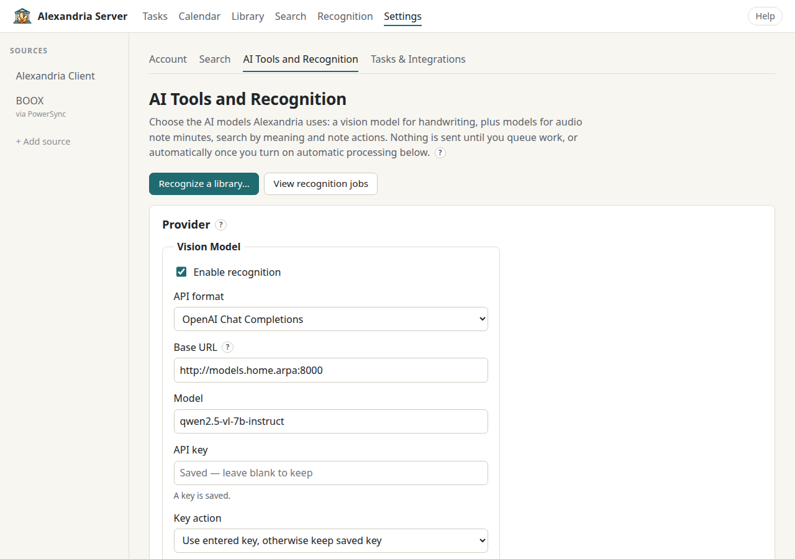
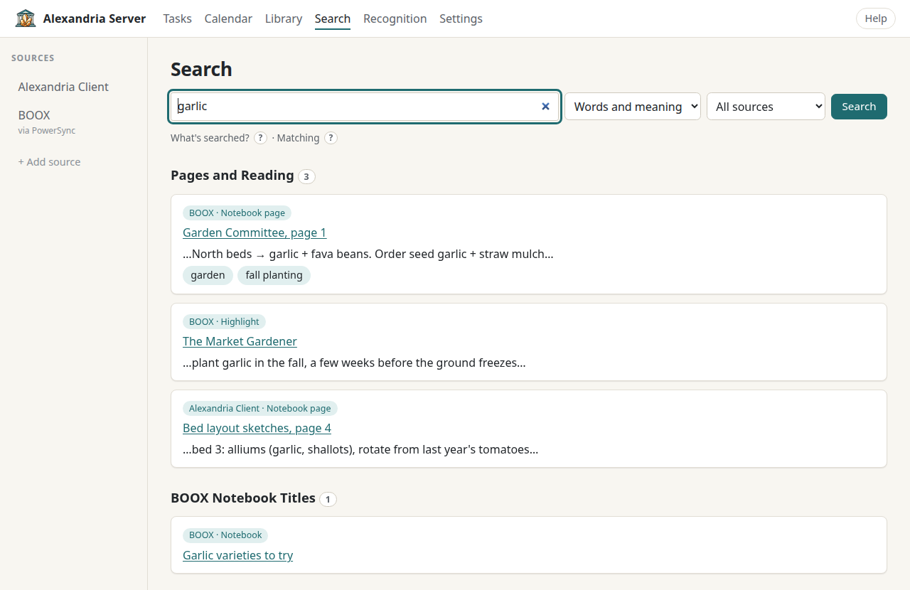
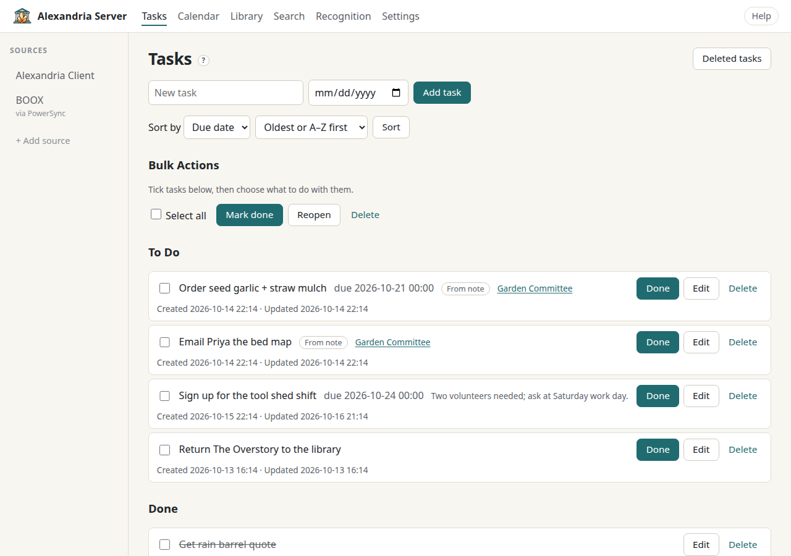
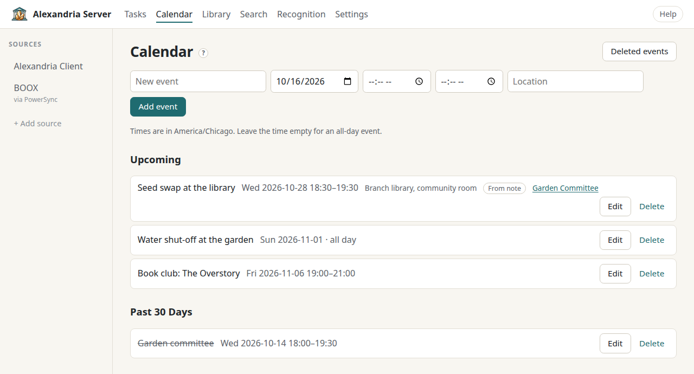
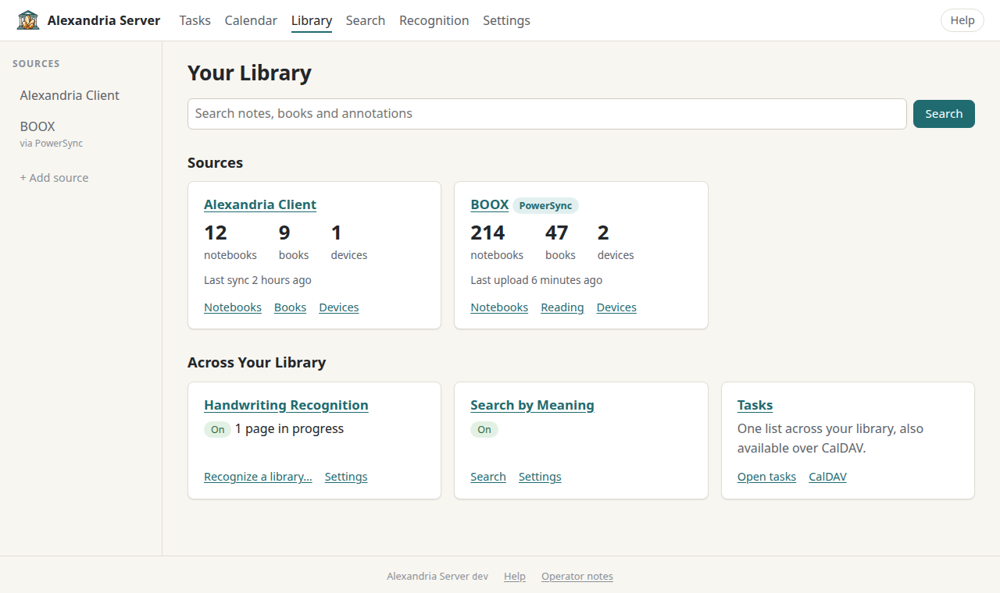

<p align="center">
  
</p>

# Aragonite Alexandria Server

**Your e-ink notes, on your own server, actually doing something.**

Alexandria Server is a self-hosted home for the handwriting, books and
highlights on your e-ink tablets. It syncs BOOX tablets natively in place of
the Onyx cloud, as well as the Alexandria Client app. Then it puts the library
to work: it reads your handwriting with AI models you choose, searches
everything, turns pen colors into tasks and calendar events, and writes
minutes from the audio you record in your notes.

<p align="center">
  
</p>

*Screenshots use a made-up demo library. See
[Regenerating the Screenshots](#regenerating-the-screenshots).*

## What It Does

### Syncs Your BOOX Library Without the Onyx Cloud

A BOOX tablet signs in to Alexandria instead of the Onyx cloud, using the
companion app PowerSync, and keeps using its own Notes app and reader as
usual. Notebooks and folders sync across several tablets, and reading
records, highlights and tags come along. In the browser you can page through
every notebook, rendered from the original pen strokes, templates and images, and
read typed-text notes and book highlights.

<p align="center"></p>

### Reads Your Handwriting With Models You Pick

Point Alexandria at a vision model: a local one served by vLLM or Ollama, or
a hosted OpenAI- or Anthropic-compatible API. It turns pages into text.
Recognize one page, a notebook or a whole library, or let automatic
recognition pick up each page once you stop writing. The prompts are editable
in Settings, and the Jobs page shows how every page is getting on.

<p align="center"></p>

### Searches Everything, by Word or by Meaning

A single search covers recognized handwriting, BOOX tags, notebook titles,
book highlights and Alexandria Client pages. Add an embedding model and it
also matches by meaning, so a search for "fall planting" finds the page that
says "garlic in October".

<p align="center"></p>

### Turns Pen Colors Into Tasks and Events

Write in **red** and it becomes a task; write in **sky blue** and it becomes
a calendar event, with the date and time read from what you wrote. Each item
links back to the page it came from. Both lists sync to phone and desktop
calendar apps over CalDAV, and you can choose which color does what, or
switch either off.

<p align="center"></p>
<p align="center"></p>

### Writes Minutes From Your Audio Notes

Record audio while you take notes on a BOOX tablet, and Alexandria writes
minutes. It transcribes the recordings with a Whisper-compatible model,
reads them alongside your handwriting, and produces key points that note
whether each one came from the recording, the notes or both. You can send
the minutes back to your tablets as a new note. Each recording shows the
pages it was made on, with a player right on the page.

<p align="center"></p>

### Lets Your AI Assistant Into Your Notes, on Your Terms

A built-in [MCP](https://modelcontextprotocol.io) server lets Claude and
other MCP clients search your notes, read pages and minutes, edit text boxes,
and manage tasks and calendar events. Each client signs in with OAuth or an
API token you can revoke.

### Also

- **Alexandria Client** (Android) syncs notebooks, books and annotations
  through its own sync protocol and shares search, recognition and tasks.
- **Book uploads** to your BOOX tablets from the browser.
- **One overview** of every source, device and job.
- **Translations:** English and Spanish.

<p align="center"></p>

## Your Data

- **It stays on hardware you run.** PostgreSQL holds the metadata, an
  S3-compatible store holds the files, and for BOOX sync a bundled Couchbase
  and Sync Gateway pair speaks the tablets' own protocol.
- **Only the AI model endpoints you configure** receive page images, recordings
  or text, and only for features you turn on. Pointing those at models on
  your own network keeps everything at home.
- **It is not end-to-end encrypted.** The server can read your library;
  that's how it searches and recognizes it. Protect it with TLS, a strong
  password and normal host security.
- **A library has one owner** with any number of devices. It isn't a shared
  workspace.

## Getting Started

Alexandria runs as a Docker Compose (or Podman Compose) stack on a single
Linux host, behind the TLS reverse proxy you already use. The installer asks
for your public address and an administrator account, generates every other
secret, and starts the stack:

```bash
git clone https://github.com/jdkruzr/AragoniteAlexandriaServer.git alexandria-server
cd alexandria-server/deploy/compose
./install.sh
```

Then follow the [guides](docs/guide/README.md):

| Guide | For |
|---|---|
| [Install Alexandria Server](docs/guide/install.md) | The installer, where data lives, upgrades, backups |
| [Put Alexandria Behind HTTPS](docs/guide/https-proxy.md) | Caddy, nginx or Nginx Proxy Manager |
| [Connect BOOX Tablets](docs/guide/boox.md) | The BOOX sync services, PowerSync, enrolling tablets |
| [Set Up AI Models](docs/guide/ai-models.md) | Recognition, minutes, search by meaning |
| [Run Models on Your Own Hardware](docs/guide/local-models.md) | Vision, Whisper and embeddings on your own GPU |

Using it: [the web app](docs/guide/web-app.md),
[recognition](docs/guide/recognition.md),
[search and tags](docs/guide/search-and-tags.md),
[tasks and calendar](docs/guide/tasks-and-calendar.md),
[note actions](docs/guide/note-actions.md),
[audio note minutes](docs/guide/minutes.md),
[AI assistants](docs/guide/assistants.md) and
[translating](docs/guide/translating.md).

## Under the Hood

- **Go server**, one binary with gateway, worker and maintenance roles
  (`ALEXANDRIA_ROLE`). Server-rendered HTML with almost no JavaScript.
- **PostgreSQL with pgvector** for metadata and search. **S3-compatible
  object storage** is the only durable blob store; local disk is scratch.
- **Durable, leased, idempotent jobs.** Kubernetes or AWS Batch can run them,
  but they never become the source of truth.
- **Explicit, checksummed migrations,** with separate management and runtime
  database credentials. Normal startup never runs privileged DDL.
- **Deployment profiles:** `deploy/compose` (single host),
  `deploy/helm/aragonite-alexandria-server` (Kubernetes against external
  PostgreSQL and S3), and `deploy/terraform/aws` (ECS/Fargate, Aurora
  Serverless v2, S3; it expects an existing VPC, DNS and certificate).
  None of them needs a subscription or the separate Hosting service.

Design and engineering notes live in [`docs/`](docs/), starting with
[Current State](docs/current-state.md). See [Architecture](docs/architecture.md), the
[AWS diagrams](docs/architecture-aws.md), the
[Development Guide](docs/development.md) and
[UltraBridge Migration](docs/ultrabridge-migration.md).

### Commands

```bash
go build ./cmd/alexandria-server

# Apply embedded PostgreSQL migrations (management credentials).
ALEXANDRIA_DATABASE_URL='postgres://...' ./alexandria-server migrate

# Run the configured role (gateway, worker, maintenance, or all).
ALEXANDRIA_DATABASE_URL='postgres://...' ALEXANDRIA_ROLE=all ./alexandria-server serve

# Create or update the local owner without a password in process arguments,
# then mint a revocable API token (shown once).
ALEXANDRIA_DATABASE_URL='postgres://...' ./alexandria-server seed-user \
  --username admin --password-file /run/secrets/alexandria_admin_password
ALEXANDRIA_DATABASE_URL='postgres://...' ./alexandria-server create-token --label laptop

# A content-free inventory of UltraBridge snapshots (names, counts, sizes only).
./alexandria-server legacy-preflight \
  --notes-db /snapshot/ultrabridge.db --task-db /snapshot/ultrabridge-tasks.db \
  --root /snapshot/supernote --output /secure/location/manifest.json
```

`make check` runs `go vet` and the race-enabled tests. The integration tests
need a fresh PostgreSQL and S3 endpoint; see the
[Development Guide](docs/development.md).

### Regenerating the Screenshots

`scripts/docs-screenshots.sh` renders the images in `docs/images` from a
made-up demo library (`TestWriteDocsScreens` in `internal/alexandria/web` and
`internal/boox`) and a fake handwritten page
(`docs/screenshots/demo-page.html`). There's no database or server
involved, so no real library can end up in a screenshot. It needs Go and
Google Chrome, and downloads the Caveat font (SIL OFL) at a pinned checksum.

## Coming From UltraBridge

Alexandria succeeds [UltraBridge](https://github.com/jdkruzr/ultrabridge).
[UltraBridge Migration](docs/ultrabridge-migration.md) covers moving over safely.

Brand usage and the generation brief for the project mark are in
[the brand note](docs/brand.md).

## License

Apache License 2.0. Code ported selectively from UltraBridge keeps its
original copyright and license notices and is listed in `NOTICE`.
