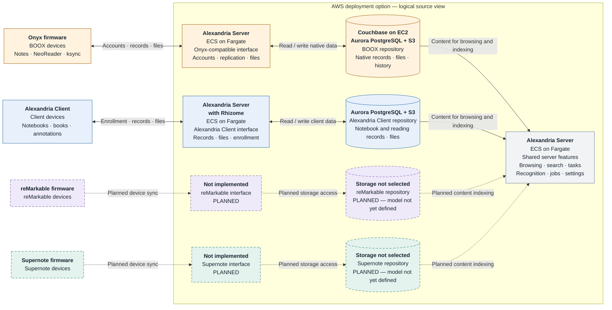
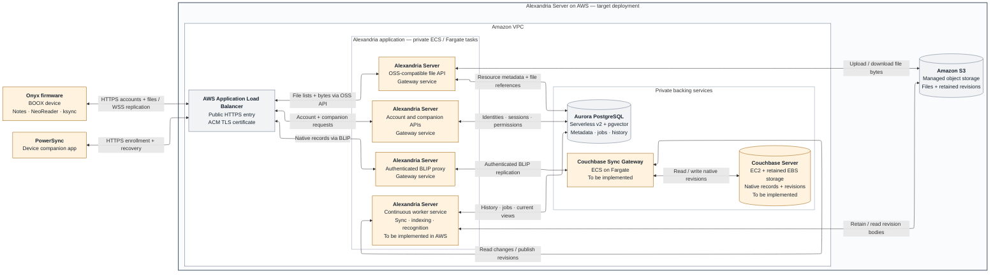

# Alexandria Server architecture on AWS

This is an AWS deployment option for the [general architecture](architecture.md).
It preserves the same source interfaces, logical repositories and data ownership,
while identifying AWS services that can host them. It is a **target design**, not
an assertion that the complete stack is already provisioned or qualified on AWS.

The repository contains an AWS infrastructure foundation. Items marked **To be
implemented** below are pinned future work; this document does not change or
apply that infrastructure. The diagram connections describe the intended data
paths, including those future deployment additions.

Bold box headers identify the software; the next line identifies its AWS hosting
service where relevant. Colors retain the general diagram's meaning: amber for
BOOX, blue for Alexandria Client, purple for reMarkable, teal for Supernote and
slate gray for shared components. Dashed paths mark planned source integrations.
Solid paths indicate the target architecture, not Terraform completion.

## Source interfaces and repositories

The logical source view remains recognizable: AWS hosts the application, Aurora
stores Alexandria's structured data, and S3 stores file bytes. BOOX retains its
Couchbase repository. reMarkable and Supernote remain planned interfaces with
undecided native data models.

[Overview SVG](diagrams/aws-source-repositories.svg) ·
[Overview PNG](diagrams/aws-source-repositories.png)

This view omits the common HTTPS entry point and network layout. A repository
still spans storage services; the drawing does not imply a database per box.

## Native BOOX sync on AWS

The outer boundary is the complete **Alexandria Server deployment on AWS**. The
VPC (Virtual Private Cloud) contains the load balancer, application tasks and
private database services. **Amazon S3 is an AWS service outside the VPC**; it is
part of the deployment's storage without being a process in a private subnet.
An S3 gateway endpoint can provide private access from the VPC.
[AWS S3 endpoint documentation](https://docs.aws.amazon.com/vpc/latest/privatelink/vpc-endpoints-s3.html).

The application remains responsible for authentication and Onyx-compatible APIs.
The Application Load Balancer (ALB) supplies the public HTTPS entry point using
an AWS Certificate Manager (ACM) certificate. It forwards WebSocket replication
traffic to Alexandria's authenticated proxy, never directly to Sync Gateway.
ALB supports WebSockets; connection idle timeouts and task draining still need
qualification with native replication. [AWS load-balancer guidance](https://docs.aws.amazon.com/AmazonECS/latest/developerguide/networking-inbound.html),
[ALB timeout configuration](https://docs.aws.amazon.com/elasticloadbalancing/latest/application/application-load-balancers.html).

[BOOX detail SVG](diagrams/aws-onyx-sync.svg) ·
[BOOX detail PNG](diagrams/aws-onyx-sync.png)

The three gateway boxes are functions of the same Alexandria application, not
three required ECS services. The continuous worker is a separate instance of
that application. It performs native observation/publication and runs recognition
in a separate loop. Other source interfaces and shared web features use the same
public entry point; they are omitted from this detail view.

Couchbase Server and Sync Gateway remain Couchbase software hosted on AWS. Aurora
replaces the PostgreSQL hosting service, and S3 replaces the configured object
store; neither replaces native Couchbase revision handling or BLIP replication.
The proposed EC2/EBS placement follows Couchbase's documented AWS deployment
options. [Couchbase cloud deployment guidance](https://docs.couchbase.com/server/current/cloud/couchbase-cloud-deployment.html).

## AWS service choices

| Responsibility | Option drawn | Other deployment option / consequence |
|---|---|---|
| Alexandria application | ECS services on Fargate for gateway and continuous worker | EC2 running the application containers offers a closer match to the standalone Compose layout. EKS can host them where Kubernetes is already operated. |
| Structured records and search | Aurora PostgreSQL Serverless v2 with pgvector | RDS for PostgreSQL is another managed PostgreSQL option; provisioning and qualification remain to be implemented. Keep PostgreSQL migrations and extension checks. |
| Files and retained revisions | Amazon S3 | Uses the existing S3 contract and library-scoped keys; SeaweedFS is unnecessary in this variant. |
| Native BOOX replication | Sync Gateway on Fargate; Couchbase Server on EC2 with retained EBS data volumes | Sync Gateway on EC2 is also an option. Kubernetes/operator or managed Couchbase offerings need separate compatibility and administrative-API evaluation. |
| Finite generic jobs | AWS Batch on Fargate | Existing launcher foundation; PostgreSQL owns job state and leases. It is not currently the recognition queue or the continuous native-sync worker. |
| Periodic maintenance | Optional EventBridge Scheduler launching an ECS maintenance task | To be implemented. Useful for reconciliation and collection; it does not replace the continuous sync/recognition worker. |
| Public entry and DNS | ALB + ACM; Route 53 or existing DNS | ALB is in the module. The certificate and DNS setup are supplied externally; Route 53 is optional. |
| Secrets, permissions and logs | Secrets Manager, IAM task roles, CloudWatch Logs | Foundation exists. Native BOOX credentials, shared settings-encryption key, dashboards and production alarms need completion. |

Aurora and RDS for PostgreSQL support pgvector; validate the chosen engine and
extension versions during provisioning. [Aurora pgvector documentation](https://docs.aws.amazon.com/rds/latest/auroraextendedcontent/aurora-faq-agentic-ai.html),
[RDS extension versions](https://docs.aws.amazon.com/AmazonRDS/latest/PostgreSQLReleaseNotes/postgresql-extensions.html).

The retained EBS volume belongs to the Couchbase host lifecycle. Do not model it
as durable storage on an ordinary ECS service task: AWS deletes ECS-managed EBS
volumes attached to service tasks when those tasks terminate. [ECS EBS lifecycle](https://docs.aws.amazon.com/AmazonECS/latest/developerguide/ebs-volumes.html).

## Implementation pins

These describe the checked-in foundation as reviewed on 2026-10-11, not live AWS
resources. **To be implemented** means future deployment work, even where the
underlying Alexandria runtime behavior already exists.

| Area | Present in repository | To be implemented / qualified |
|---|---|---|
| Public gateway | ALB, HTTP-to-HTTPS redirect, Fargate gateway task/service | Full current application configuration, native WebSocket reconnect/drain behavior, readiness routing and rollout qualification |
| PostgreSQL and objects | Aurora Serverless v2, private database access, encrypted/versioned S3 bucket | Current migrations and pgvector on selected engine; complete multi-store backup/restore rehearsal |
| Native BOOX services | Standalone Compose definitions and application protocol implementation | Couchbase EC2/EBS provisioning, Sync Gateway service, private service discovery, network rules, bucket/bootstrap setup and secrets |
| Continuous background work | `worker` role without a job ID runs native sync, indexing and recognition loops | An always-running ECS worker service; shared provider/settings configuration and multi-worker qualification |
| AWS Batch | Queue, Fargate compute environment, job definition and submit-by-ID launcher | Further handlers and execution wiring as needed; `RunJob` currently handles `blob.verify`, not recognition jobs |
| Scheduled maintenance | A one-shot `maintenance` role | Optional EventBridge schedule and execution permissions; the role currently reconciles jobs and collects assets |
| Networking | Module accepts an existing VPC and public/private subnet IDs | Supplied routes, S3 endpoint and required outbound access to AWS services and configured recognition/embedding providers |
| Setup and operations | Management task, separate management/runtime secrets, IAM, CloudWatch logs | BOOX initialization, settings key distribution, alarms and backup automation; qualify the complete deployment |
| reMarkable / Supernote | Architectural stubs | Source protocols, schemas and device workflows; AWS hosting does not implement these connectors |

EventBridge Scheduler can invoke ECS `RunTask`, making it a candidate for the
maintenance task. This remains a proposal, not an existing scheduler resource.
[AWS scheduled-task documentation](https://docs.aws.amazon.com/AmazonECS/latest/developerguide/tasks-scheduled-eventbridge-scheduler.html).

The current Terraform `ha` option increases gateway and Aurora instance counts;
it does not establish end-to-end high availability for native BOOX sync. Couchbase,
Sync Gateway, worker coordination and recovery need their own design and testing.
Likewise, Aurora's economy setting permits zero capacity, but open database
connections prevent auto-pause; a continuous sync workload should not assume it
will sleep or cost nothing when the user is idle. [Aurora auto-pause conditions](https://docs.aws.amazon.com/AmazonRDS/latest/AuroraUserGuide/aurora-serverless-v2-auto-pause.html).

## Code and design references

- [General architecture](architecture.md): source semantics and deployment-neutral diagrams.
- [AWS Terraform](../deploy/terraform/aws/main.tf), [variables](../deploy/terraform/aws/variables.tf): infrastructure foundation and profile choices.
- [Application roles](../cmd/alexandria-server/main.go): gateway, continuous worker, one-job worker and maintenance behavior.
- [Job launcher](../internal/jobs/launcher.go) and [library runtime](../library/runtime.go): durable job state and current handlers.
- [Native BOOX Compose services](../deploy/compose/boox.yml): existing Couchbase/Sync Gateway deployment reference.
- [Deployment setup](deployment-identity-upgrade.md): explicit migrations and privilege separation.
