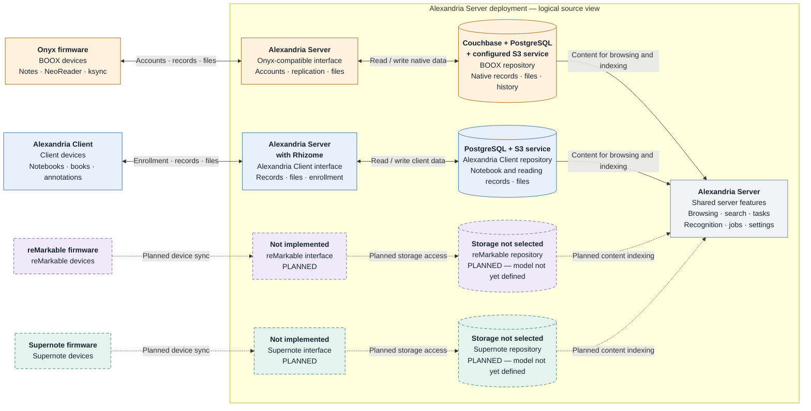
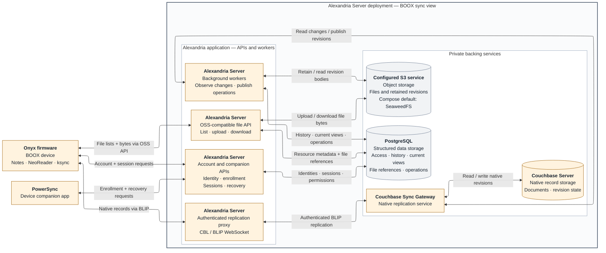

# Alexandria Server architecture

Alexandria Server synchronizes and organizes notes, books and related data from
supported applications and e-ink devices. It provides a web interface for browsing
that data, searching across sources and managing processing such as handwriting
recognition. **Alexandria Client** is a separate notes and reading application that
can sync with the server; BOOX devices use their built-in applications instead.

This guide describes the software's components and data ownership, independently
of where it is installed. It does not require a particular cloud provider,
filesystem or container platform.

For a separate version mapped to AWS services, see the
[AWS deployment architecture](architecture-aws.md), including options and
explicitly marked deployment work still to be implemented.

Four terms recur throughout the diagrams:

- **Library:** one person's collection and server state. A library can contain
  multiple sources and serve multiple devices.
- **Source:** a note or reading environment, such as Alexandria Client or the
  native BOOX applications. Each source keeps its own content model and devices.
- **Sync interface:** the server APIs and protocol handling through which a
  source exchanges data with Alexandria.
- **Repository:** a source's logical data store, including its records, files and
  sync history. Here this means stored data, not a Git repository. One repository
  can span several storage services.

## Source interfaces and repositories

Each source has its own sync interface, identities, data model and repository.
Shared server features use those repositories through source-specific code; they
do not turn BOOX notebooks into Alexandria Client notebooks.

[Open the overview as SVG](diagrams/source-repositories.svg) ·
[PNG preview](diagrams/source-repositories.png).

Bold headers identify the software implementing each component or storing its
data; the lines below describe its role. Rhizome is used within Alexandria Server,
not a separate deployed service. A logical repository can name several storage
services because its records and files live in different places. Planned
components explicitly identify missing implementations or undecided storage.

The outer boundary includes the application and the backing services that support
one owner's library. This overview groups data into logical repositories; it does
not map each box to a process or database server. The Onyx detail below separates
the application from its backing services.

Colors identify which source a component belongs to, consistently across both
diagrams. They do not indicate health, progress or implementation status.

| Color | Meaning |
|---|---|
| Amber | BOOX devices, integration components and dedicated native sync storage |
| Blue | Alexandria Client devices, sync interface and repository |
| Purple | Planned reMarkable integration |
| Teal | Planned Supernote integration |
| Slate gray | Shared server features or storage services used by multiple sources |

Names and line styles carry the same distinctions when viewed without color.
Arrow labels describe the exchanged data or operation; a two-headed arrow groups
reads and writes or request/response traffic, rather than implying that either
endpoint can initiate a connection. The detail view names the protocols where
they matter.

Solid paths are implemented. Dashed paths are planned integration points, not
claims about an implemented protocol or its final sync direction. Arrows from
repositories to shared features represent reading and indexing source data.
Writes and recovery must still pass through the owning source's rules; the shared
UI is not a bypass.

**Logical separation does not require separate PostgreSQL servers or S3 buckets.**
The two implemented repositories share a library-scoped PostgreSQL database and
object storage. BOOX additionally needs Couchbase Server and Couchbase Sync
Gateway, which handle the database replication expected by BOOX firmware. The
next section explains how these services divide the work.

## Physical storage and authority

Alexandria uses three kinds of persistent storage:

- **PostgreSQL** stores structured records, configuration and job state. Its
  **pgvector** extension supports vector search for features such as searching
  by meaning.
- **S3-compatible object storage** stores file contents: books, notebook resources
  and other binary data. S3 is the storage API contract; the service can be
  self-hosted or provided by a cloud vendor.
- **Couchbase Server**, accessed through **Sync Gateway**, stores the native BOOX
  records and their revisions. These services are required for the native BOOX
  integration, not for Alexandria Client sync alone.

The table shows how logical repositories use those services. A **projection** is
a queryable copy of native data prepared for the server's features; an **asset**
or **resource** is file content referenced by a record. File metadata and file
bytes can therefore live in different stores.

| Store | Alexandria Client repository | BOOX repository | Shared server state |
|---|---|---|---|
| PostgreSQL / pgvector | Notebook, page, reading and annotation records; sync state and file manifests | Device permissions; observed revision metadata; current projections; file versions and references; records of publication/recovery operations | Settings, tasks, jobs, recognition results and search indexes |
| S3-compatible object storage | Immutable file chunks for book and notebook content | Immutable uploaded resources and retained copies of native revision bodies | Other files, such as task attachments |
| Couchbase Server, behind Sync Gateway | Not used | Native replicated documents and revision state, including notebook, reading and sync-control records | Not used |

Alexandria Client uses **Rhizome**, the sync layer that handles record exchange,
merging and file publication. For BOOX, native Couchbase revision selection remains
authoritative for replicated records. PostgreSQL's BOOX projection follows that
winner; it does not elect a different winner based on a newer timestamp. Uploaded
binary resources travel through a separate file API, rather than inside that
replication stream. Receiving a record does not by itself mean the server or a
peer device has received every file it references.

All S3 keys supplied to the runtime are scoped beneath `libraries/<library-id>/`.
Examples within that scope are `assets/chunks/`, `boox/bodies/` and
`boox/revisions/`. These are logical namespaces in the same storage service, not
necessarily separate buckets. The filesystem beneath a database or object-storage
service is a deployment choice, subject to that service's durability and I/O
requirements. The architecture requires persistent database and object storage;
temporary application scratch space is not a substitute. Provider configuration,
disk placement and backups belong in the [deployment storage guide](deployment-storage.md).

## Inside the Onyx-compatible interface

The **Onyx-compatible interface**, also called the facade, implements the server
APIs expected by BOOX's built-in Notes and **NeoReader** reading applications.
**PowerSync** is a companion app installed on the device to enroll it, select its
server and assist with recovery. The device's existing **ksync** background
service continues to perform native synchronization.

There are three main paths between the device and server:

1. **Account APIs** establish identity, sessions and access. PowerSync also has
   companion APIs for enrollment and recovery.
2. **Database replication** exchanges native records through an authenticated
   proxy to Sync Gateway. The device uses **Couchbase Lite (CBL)** and its **BLIP**
   replication protocol over a WebSocket connection. This connection carries
   replication data, not just notifications.
3. **File APIs** list, upload and download the resources referenced by those
   records. These APIs reproduce the **OSS** object-storage interface expected
   by BOOX. Alexandria stores the bytes in its S3-compatible storage; the
   device-facing and storage-facing APIs need not be the same.

The diagram shows these main data paths. Authorization checks and administrative
calls are omitted to keep the flow readable.

The **Alexandria Server deployment** includes both the **Alexandria application**
(APIs, authentication, replication proxy and background workers) and its private
backing services. Couchbase Server and Sync Gateway run as separate services
within that deployment, alongside PostgreSQL and object storage. They are part
of the native BOOX integration, even though they are not Alexandria application
code.

These boundaries describe system responsibilities, not a requirement to run
everything on one machine. Backing services can be self-hosted or managed
services. Devices connect through Alexandria's public APIs; they do not connect
directly to the backing services. TLS termination and other source interfaces
are omitted from this BOOX-focused view.

[Open the Onyx detail as SVG](diagrams/onyx-sync.svg) ·
[PNG preview](diagrams/onyx-sync.png).

The object-storage software is configurable. SeaweedFS is the bundled Compose
default, not an architectural requirement; another compatible S3 service can
fill the same role.

Couchbase and Sync Gateway perform native replication and revision handling.
Alexandria provides the compatible account and file APIs, controls device access,
retains resources and observed history, and decodes source data for browsing.
Its workers observe replicated changes and carry out supported publication or
recovery operations with checks against stale revisions and missing resources.

Three events remain distinct: a record reaches the server, its referenced files
become available, and a device's native application applies the incoming content.
Success at one stage does not establish success at the next.

The observer can retain only revisions it actually sees. This is not a guarantee
that every transient or device-local losing edit has been archived. Likewise,
ordinary previews and recognition do not publish edits back to native notebooks.

## Alexandria Client interface

Alexandria Client syncs its notebook and reading records through Rhizome. Record
sync and resumable file transfer are separate paths: PostgreSQL holds records
and sync state, while object storage holds file chunks. A publication step checks
that the required content is ready before making an uploaded asset available.

Each device has its own credentials. A library generation identifies the current
version of the library after a replacement or restore, preventing an older device
session from writing into the replacement accidentally. This interface has its
own devices and conflict rules, separate from the BOOX sync domain.

For developers, the main API groups are:

- `/sync/devices/v1/*`: device enrollment and administration.
- `/sync/capabilities` and `/sync/v1`: capability/schema negotiation and row sync.
- `/sync/assets/v1/*`: separate, resumable asset transfer and publication.
- `/sync/restore/v1/*`: explicit library replacement and device adoption.
- `/reader/search`: client-facing reader search.

## Future reMarkable and Supernote connections

The dashed components reserve the same architectural positions as the implemented
sources: a vendor-facing interface, an owned source repository, and integration
with shared browsing/indexing/processing. They do **not** yet specify endpoint
contracts, schemas, file formats, merge policy or complete write-back behavior.

The intended storage baseline is PostgreSQL for source metadata and S3-compatible
storage for file bodies, subject to the actual protocol requirements. Native
identities, deletion semantics, versions and device registrations remain owned by
each adapter rather than being forced into the Alexandria Client row schema.

Neither connector is implemented. Placeholder routes or source names in the code
do not establish support for synchronizing those devices. If a future vendor
interface uses notifications to trigger a download, durable sync state must
survive a missed notification; the mechanism is still to be specified.

BOOX WebDAV/export ingestion is also a separate future source. It must not be
confused with the implemented native BOOX/Couchbase interface shown here.

## Shared features and execution

The web UI separates source-specific notebooks, reading data, devices and settings
from global search, tasks, recognition jobs and server settings. Search can combine
supported source results without merging their underlying content models. BOOX
task extraction/write-back remains future work; a global Tasks page does not imply
that every source already produces tasks. Shared features support each source
explicitly; adding a connector does not automatically provide every feature.

The reusable `library` runtime contains the behavior for one owner's library.
The standalone server hosts that runtime directly. A separate hosting service
can also embed it to provide isolated libraries for different customers; such a
service is not required for self-hosting.

Devices and web browsers connect to Alexandria over HTTPS, with secure WebSocket
connections for native BOOX replication. A deployment can terminate TLS at a
reverse proxy or an equivalent ingress service. PostgreSQL, object storage,
Couchbase and Sync Gateway are backing services; devices do not need direct
access to them. In particular, BOOX replication passes through Alexandria's
authenticated proxy before reaching Sync Gateway.

The application supports a gateway role for requests, a worker role for queued
processing, a maintenance role for periodic work, and a combined role. Deployments
can run these together or separately. Recognition work is isolated from native
sync maintenance so slow processing providers do not stall sync.

Handwriting recognition uses an optional **OCR** (optical character recognition)
provider. Search by meaning uses an optional **embedding** provider, which converts
text into vectors for similarity searches. These providers process content; they
do not decide which source revision wins during sync.

The Compose distribution includes an optional CPU-only Ollama embedding service.
Its private endpoint and persistent model cache can be provisioned while semantic
search remains disabled in application Settings. Starting a provider, enabling
its use and requesting an index build are separate operations. See
[local embedding deployment](deployment-compose.md#optional-cpu-embedding-service).

Queued jobs and their progress are stored in PostgreSQL. Workers claim a temporary
lease before processing a job, allowing another worker to recover it if the first
stops. Repeated execution must not duplicate published results, and maintenance
recovers missed wake-ups or expired leases. Local scratch files and caches are
disposable. This processing queue is distinct from the BOOX operation journal,
which tracks the stages of native publication and recovery.

## Search visibility and source lifecycle

Search results represent current live content, not every retained native record.
There is no one-to-one mapping between Couchbase documents and search entries:
control records are not searchable content, and a notebook can have many indexed
pages. BOOX metadata search queries PostgreSQL's current native projection;
recognized page text uses its PostgreSQL full-text index. Couchbase does not
maintain that application index automatically.

The BOOX observer consumes Sync Gateway changes, retains observed revisions and
projects the current winner. A native soft deletion changes the winner's status;
a hard tombstone removes the current projection. Search and Reading share
source-aware visibility rules: notebook status `1` is active, while NeoReader
book/highlight/bookmark status `0` is active. For compatibility, missing/null
statuses retain those source defaults; other unrecognized values are excluded.
Commit/control documents are excluded. An annotation or bookmark is visible only
when its parent book is also active in the same native account. Its `documentId`
references the book's native `uniqueId`, not the prefixed Couchbase document ID.
Children arriving first wait for their parent. Restoring a book does not restore
an independently deleted child. These checks apply before pagination and to
direct Reading links, as well as global web search.

Notebook metadata and OSS live-resource binding changes invalidate previously
requested page recognition in the same PostgreSQL transaction: published text is
cleared, the job leaves the searchable ready state, and its version/lease changes.
Workers recheck the current page catalog and resource completeness; late results
cannot publish against an invalidated job. Search additionally requires a live
parent notebook. Retained revisions, resource bytes and cached recognition text
remain available for their recovery/cache purposes without becoming search hits.
Recognition remains explicitly requested; receiving all files does not imply
that all handwriting or book contents have been indexed.

Visibility is eventually consistent with Couchbase: a deletion accepted there
can remain visible until the observer commits its projection update. A new search
after that commit excludes the deleted content. Worker outages extend this
catch-up window; an already rendered browser page needs a refresh. OSS binding
invalidation occurs when the supported file API commits the binding change.

Lifecycle regression coverage lives in `internal/boox/search_lifecycle_test.go`:
HTTP search/browsing, parent ordering and account boundaries, observer-driven
deletion/restoration with retained history, and page/resource deletion during
recognition. These checks do not promise full-text or semantic coverage for source
types that have not yet been integrated with those search interfaces.

## Code and design anchors

| Boundary | Current implementation / supporting documentation |
|---|---|
| Library admission and interface routing | [`library/runtime.go`](../library/runtime.go) |
| Alexandria Client protocol | [`internal/alexandria/host/host.go`](../internal/alexandria/host/host.go), [`assetstore/store.go`](../internal/alexandria/assetstore/store.go) |
| Onyx facade and native replication | [`internal/boox/service.go`](../internal/boox/service.go), [`proxy.go`](../internal/boox/proxy.go), [`oss.go`](../internal/boox/oss.go) |
| BOOX observation and publication | [`internal/boox/journal.go`](../internal/boox/journal.go) |
| BOOX PostgreSQL repository | [`migrations/0015_native_boox.sql`](../migrations/0015_native_boox.sql) and subsequent migrations |
| Library-scoped object storage | [`internal/blob/scoped.go`](../internal/blob/scoped.go) |
| Private Couchbase / Sync Gateway services | [`deploy/compose/boox.yml`](../deploy/compose/boox.yml) |
| Server assembly and unimplemented protocol placeholders | [`internal/server/server.go`](../internal/server/server.go) |
| Source UI and recognition | [Source browser](source-browser-and-boox-reader.md), [recognition jobs](recognition-jobs.md) |
| Deployment storage and backup | [Storage layout](deployment-storage.md) |

## Shared semantic search (2026-10-13)

Semantic search is derived application data in PostgreSQL/pgvector. The optional
Ollama service embeds text; it does not interpret native ink or replicate documents.
Couchbase/Sync Gateway and native object storage remain the BOOX source authorities.

Migration 0023 connects current BOOX text to `alexandria_note_content`, alongside
Alexandria Client text. BOOX notebook text comes from completed server recognition;
reading text comes from current book titles, highlights and annotation notes. No
whole-book extraction or device OCR import is implied. Notebook pages use stable
notebook/page identifiers rather than page numbers; reading records retain their
native document identifiers. Source revision metadata supports currentness checks.

Database triggers refresh derived text on recognition/projection changes. Reading
children require a live parent in the same account, including when arrival is out
of order. Source invalidation removes stale text; deletion removes its vectors in
all generations and invalidates outstanding work. Query-time source checks reject
stale records independently of cleanup. Candidates are checked again after query
embedding to catch edits/deletions during inference. Embedding completion retains
its existing lease/version and text-hash checks. Source history stays separate.

The shared `alexandria_search_live` view supplies current content and source-aware
result metadata. Global web, JSON API and MCP search embed a query once across
selected sources and combine keyword/vector ranks. BOOX reading keyword matches
also retain the existing case-insensitive substring behavior for titles and text. `source=client` (or the API/MCP
alias `forestnote`) and `source=boox` narrow results; omitted scope searches both.
The legacy Go `Searcher.Search` method remains client-only; `SearchScoped` is the
shared entry point. An unavailable embedding provider falls back to keyword search.
Client reading annotations and BOOX notebook-title matches remain supplemental
keyword-only web results. BOOX result links resolve stable page IDs on navigation.
MCP BOOX results use web links rather than advertising client-only image tools.

The upgrade backfills only already available text. It neither enables embeddings
nor enqueues handwriting recognition. Existing active/building generations receive
text changes through the same work queue; the disabled feature pauses processing.
An explicit index build includes both sources. Settings displays per-source text,
active-index coverage and outstanding/failed work, plus native pages still lacking
current recognition text. Handwriting recognition remains an explicit, separately
managed Jobs operation with its own provider and potential costs.
