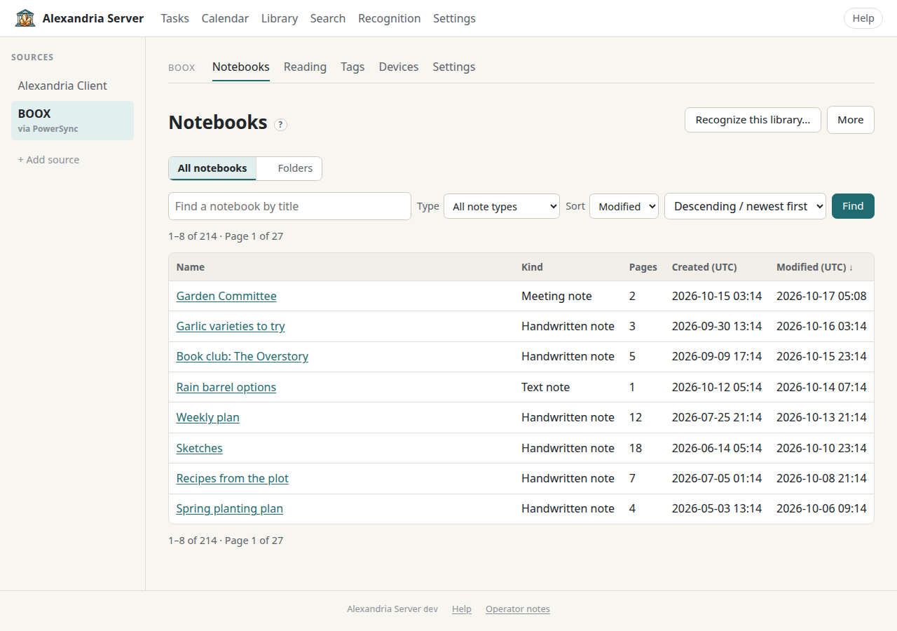
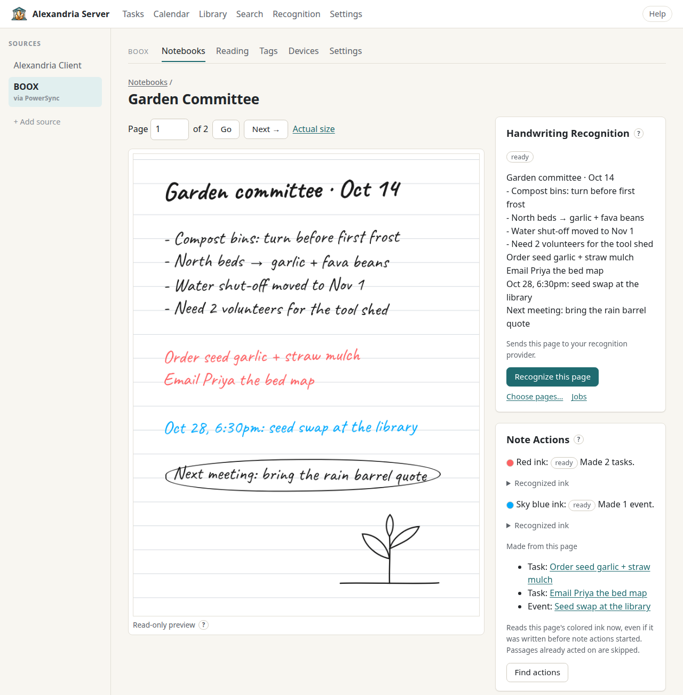

# Connect BOOX Tablets

Alexandria Server can stand in for the Onyx cloud. A companion app called **PowerSync** points a BOOX tablet's built-in Notes and NeoReader sync at your server, so your notebooks, folders and reading records land in your own library, in their native format. You browse them on the web, search them, recognize their handwriting, and send a few things back: books, text notes and Audio Note Minutes. Your tablets keep working the way they always have; they just sync somewhere you control.



## What You Get

- **Notebooks and folders**, browsable on the web with read-only page previews drawn from the ink the server has received.
- **Reading records** from NeoReader: books, highlights, bookmarks and notes.
- **Tags** you add on the tablet with the lasso's Tag action. They're read-only here, but searching for a tag finds its pages even when the handwriting doesn't say it.
- **Book upload**: send EPUB, PDF, MOBI and AZW3 books, or folders of them, to your tablets' native libraries.
- **Things sent to the tablet**: [Audio Note Minutes](minutes.md) and text notes arrive as ordinary BOOX text notebooks.
- **Handwriting recognition, search and note actions** on BOOX pages. See [Recognize Handwriting](recognition.md), [Search and Tags](search-and-tags.md) and [Note Actions](note-actions.md).

Browsing never changes your tablets. Only a handful of actions write back (deleting numbered notebooks, uploading a book, refreshing reading data, sending a text note or minutes, and audio recovery), and each one tells you so before you confirm. Changes made through the [WebDAV book folder](#manage-books-from-a-file-manager-webdav) also write back, as a file manager's changes do.

## What You Need First

- A working server from [Install Alexandria Server](install.md), behind HTTPS ([Put It Behind HTTPS](https-proxy.md)). **BOOX sync requires a real `https://` public address**: PowerSync refuses plain HTTP, and there's no certificate bypass. `ALEXANDRIA_PUBLIC_URL` in `deploy/compose/.env` must be that address, with no path.
- Your reverse proxy must pass WebSocket upgrades and keep long-lived connections open (tablets hold a sync connection), and allow request bodies of at least 129 MiB (books go up to 128 MiB, page files up to 64 MiB). The Caddy example printed by `install.sh` does all three; see [Put Alexandria Behind HTTPS](https-proxy.md) for nginx and Nginx Proxy Manager.
- The optional BOOX services: Couchbase Server and Sync Gateway, which the `boox.yml` Compose override adds. Setup is below.
- The PowerSync app on each tablet.
- **All your tablets signed in to the same BOOX account.** One library has one owner; the tablets share it.

## Turn On the BOOX Services

Everything happens in `deploy/compose/`. The commands below use the `compose` helper from `common.sh`, which picks Docker or Podman and adds the BOOX files for you once BOOX is enabled. Running each one in `sh -c` keeps your `.env` secrets out of your interactive shell.

1. **Write the Sync Gateway startup file.** Put it somewhere private (for example a directory only root can read), and make the file itself readable by the container. Choose a Couchbase administrator name and a strong password; you'll use them in the next steps.

   ```json
   {
     "bootstrap": {
       "server": "couchbase://couchbase",
       "username": "CHOOSE_A_NAME",
       "password": "CHOOSE_A_STRONG_PASSWORD",
       "use_tls_server": false
     },
     "api": {
       "public_interface": "0.0.0.0:4984",
       "admin_interface": "0.0.0.0:4985",
       "admin_interface_authentication": true
     },
     "logging": { "redaction_level": "full" }
   }
   ```

2. **Add the BOOX settings to `.env`:**

   ```sh
   ALEXANDRIA_BOOX_ENABLED=true
   ALEXANDRIA_BOOX_GATEWAY_CONFIG=/absolute/path/to/boox-gateway.json
   ALEXANDRIA_BOOX_GATEWAY_USERNAME=CHOOSE_A_NAME
   ALEXANDRIA_BOOX_GATEWAY_PASSWORD=CHOOSE_A_STRONG_PASSWORD
   ```

   The Gateway username and password are what Alexandria uses to talk to Sync Gateway's admin interface, which checks them against Couchbase users. Using the same Couchbase administrator as in the startup file is the simplest choice. If you use bind-mounted storage (`ALEXANDRIA_DATA_DIR`), also set `ALEXANDRIA_COUCHBASE_DIR` to an existing, empty directory.

3. **Start Couchbase on its own:**

   ```sh
   sh -c '. ./common.sh; compose up -d couchbase'
   ```

4. **Set up the Couchbase cluster and its bucket.** Alexandria expects a bucket named `neocloud` (change it with `ALEXANDRIA_BOOX_DATABASE`). On a single host, it should have no replicas. With Couchbase's command-line tool:

   ```sh
   sh -c '. ./common.sh; compose exec couchbase couchbase-cli cluster-init -c 127.0.0.1 \
     --cluster-username CHOOSE_A_NAME --cluster-password CHOOSE_A_STRONG_PASSWORD \
     --services data --cluster-ramsize 1024'
   sh -c '. ./common.sh; compose exec couchbase couchbase-cli bucket-create -c 127.0.0.1 \
     -u CHOOSE_A_NAME -p CHOOSE_A_STRONG_PASSWORD \
     --bucket neocloud --bucket-type couchbase --bucket-ramsize 512 --bucket-replica 0'
   ```

   Those commands put the password in your shell history. If you'd rather avoid that, use the Couchbase web console instead: it listens only on the server itself at `127.0.0.1:18091` (`ALEXANDRIA_BOOX_CB_ADMIN_PORT`), so reach it through an SSH tunnel.

5. **Start everything**, including Sync Gateway. The server waits until the Gateway is healthy.

   ```sh
   sh -c '. ./common.sh; compose up -d'
   ```

6. **Let Alexandria configure its Gateway database.** This is a one-time step for each library. It creates the database, turns off guest access, and installs this library's ownership checks. Normal startup never does it for you.

   ```sh
   sh -c '. ./common.sh; compose run --rm alexandria boox-configure'
   sh -c '. ./common.sh; compose restart alexandria'
   ```

   It's safe to run again on the same library. It refuses a Gateway database that belongs to a different library.

Sign in to the web app. The sidebar's **Sources** list now shows **BOOX** *via PowerSync*. If it doesn't, see Troubleshooting.

Neither Couchbase nor Sync Gateway gets a public port. Tablets only ever talk to Alexandria, which checks each device and forwards to the Gateway.

**Backups:** with BOOX turned on, `backup.sh` and `restore.sh` refuse to run, because Couchbase has to be backed up together with everything else. Use `backup-cold.sh`, which needs bind-mounted storage (`ALEXANDRIA_DATA_DIR` and `ALEXANDRIA_COUCHBASE_DIR`). It also saves the Gateway startup file. See [Install Alexandria Server](install.md).

## Connect Your First Tablet

1. On the tablet, sign in to the BOOX account whose library you want on the server. The first tablet decides which account this library belongs to.
2. Install **PowerSync** on the tablet.
3. In the web app, open **BOOX → Devices** and choose **Connect a device**. The **Connect a BOOX Device** page shows your server's address.
4. Choose **Create enrollment code**. The code is eight letters and digits, works **once**, and expires after **ten minutes**. Lowercase is fine. If it expires, choose **Create another code**.
5. In PowerSync, enter the server address exactly as the page shows it, type the code, and follow PowerSync's prompts to connect.
6. In PowerSync, turn on notebook and reading sync to send content to the server.

Your existing BOOX library stays on the tablet. The first sync uploads it, so a large library takes a while: notebook records arrive first, then page files. Until a page's files arrive, its preview may be missing. That doesn't mean the page is blank.

## Add More Tablets

Repeat the same steps on each tablet, with a fresh code each time. Every tablet must be signed in to the same BOOX account as the first one, or be signed out. A tablet signed in to a *different* account is refused, and its code stays unused, so you can fix the sign-in and try again.

A tablet that has drifted from the others (for example one that kept syncing to the Onyx cloud) can bring conflicting copies of the same notebook. Alexandria follows the winner that the tablets' own sync picks, and that isn't always the most recent edit. The server keeps every version it has seen, but back up anything precious on that tablet first (a BOOX local backup or an export).

## Revoke a Tablet or Go Back to Onyx

These are two different things:

- **Revoke** (BOOX → Devices → **Manage** → **Revoke device**) cuts the tablet off from this server almost immediately. Its notes stay in your library. The tablet isn't switched back to Onyx; it just can't sync anymore. To let it back in, connect it again with a new code.
- **Return to Onyx**: use **Restore** in PowerSync on the tablet. That switches its sync back to the Onyx cloud and doesn't need this server. Revoke it here afterward if you're done with it.

## Everyday Use

### The BOOX Tabs

| Tab | What it's for |
|---|---|
| **Notebooks** | Every notebook and folder. Switch between **All notebooks** and **Folders**, filter by **Type** (handwritten, text, reading or other notes), sort, and find by title. The **More** menu has **Clean up numbered notebooks…**, **Deleted notebooks** and **Connect a device**. **Recognize this library…** starts a whole-library recognition review. |
| **Reading** | A bookshelf with **Stored Here**, **All Books**, **Metadata Only**, and **Your Reading** views. Open a book for its highlights and bookmarks; page and progress values remain as recorded by the tablet. |
| **Tags** | Every lasso tag, with how many pages and notebooks use it. Open a tag to list its pages, or choose **Search for it**. |
| **Devices** | Connected tablets: **Authorized** or **Revoked**, and **Last Upload Received**. *Authorized* means the tablet may connect, not that everything has finished uploading. |
| **Settings** | Your connection address, library maintenance links, and diagnostics. |

A page count shown as *500+* is a limit of the tablet's metadata. Open the notebook to see every page.

### The Notebook Viewer



Step through pages with **← Previous** and **Next →**, or type a page number and choose **Go**. Toggle between **Fit page** and **Actual size**. The preview is drawn on the server, so pen textures are approximate. Text notebooks also show their typed **Page Text**.

The side panel shows, when they apply:

- **Handwriting Recognition**: the page's recognition state and text, **Recognize this page**, **Choose pages…** and a link to **Jobs**. Recognized BOOX text stays on the server and never changes your notebooks.
- **Note Actions**: tasks and events found in colored ink, with **Find actions**. See [Note Actions](note-actions.md).
- **BOOX Tags** on this page and elsewhere in the notebook.
- **Recordings on This Page**, playable in the browser.
- **Audio Note Minutes**: **Summarize this note…** or **Open minutes**. See [Audio Note Minutes](minutes.md).
- **Source and History**: **Recover audio…** (repairs recordings hit by a known BOOX audio defect) and **Observed native versions**.

Deleted notebooks stay viewable under **Deleted notebooks**. Viewing one doesn't restore it.

### Browse and Upload Books

**Stored Here** opens by default and includes books whose source file is present
in Alexandria's native BOOX storage. **Metadata Only** shows books whose reading
records arrived without a source file; **All Books** combines them. A cover,
device path, or sync flag alone does not mean the source file is stored here.
Your browser remembers the chosen view and bookshelf/list layout. Search, status
filters, folders, breadcrumbs, and pagination help narrow a larger library.

1. Open **BOOX → Reading → Upload books…**.
2. Choose a destination, then **Choose files…** or **Choose folder…**. Select up
   to 1,000 files, with a maximum of 128 MiB per EPUB, PDF, MOBI or AZW3 book.
3. Review the preview. The selected top-level folder and its subfolders become
   native BOOX shelves. Matching names under the same parent reuse that shelf;
   if multiple shelves match, choose one. Empty folders and unsupported files
   are skipped.
4. Choose **Import books**. Two files transfer at a time. Each has its own status
   and retry; a failed file doesn't stop the others.

Keep the page open during transfers. Its address preserves the import, and
**Continue your last import** returns to it later. Reselect unfinished files or
the original folder to resume; accepted files aren't transferred again. Changed
files need a new import. The single-file form also works without JavaScript.

**Published** means available in native sync. Tablets with reading sync enabled
list the book and download its source when opened. Server storage does not prove
that a tablet has downloaded it. Folder relationships are native shelves; the
underlying source-object keys keep BOOX's canonical layout.

A book your tablets already know only through a cloud account (for example the Nextcloud
WebDAV account) is not duplicated: uploading it replaces that entry with a stored book
on the shelf you chose, carrying over its reading progress, highlights and bookmarks. The
file stays in the cloud service. If the tablets created more than one entry for the file,
the most recently read one's progress is kept and every entry's highlights move over.
A book a tablet imported from its own storage is still refused. Opening the same file
again from the tablet's cloud-account view brings its old entry back beside the stored
book, with its own progress; read from the stored copy, or remove the cloud one on the
tablet.

Identical bytes reuse an existing upload, even under a different filename. A book
already on one shelf is not added to another: tablets keep each book on a single
shelf, so that file is blocked with a note to move the book instead. Uploads do not replace,
rename, restore, or automatically attach bytes to a metadata-only book with a
matching native fingerprint. A destination changed or removed during publication
blocks that file so it can be reviewed safely.

**Your Reading** shows current New / In Progress / Finished counts, highlights,
bookmarks, and recently accessed books across all active books. These come from
the native reading records already received by Alexandria. BOOX's separate timed
statistics database/service is not imported, so this view does not invent daily
minutes, streaks, or completion dates.

If a book's ink or annotations look stale on a tablet, open the book's **Reading Details** and choose **Refresh received reading data**, then **Request refresh**. Then open the book on each tablet and accept Sync if prompted.

When an upload replaced a cloud-account entry (see above), the same page lists that
book's **Earlier copies**: the other entries your tablets keep for the file, with their
progress and when they were last read. **Use this reading position** moves the stored
book to that copy's page and keeps its own highlights, bookmarks and reader settings.
Open the book on each tablet and accept Sync; the Library shows the new progress after
that, in the tablet's own page count.

### Manage Stored Books on the Reading Page

Books stored here have **Select** and **Download** under them. Select several and
choose **Move selected…** or **Move selected to Trash…**; a book's own page also
offers **Rename…**, **Move…** and **Move to Trash…**. Each change is reviewed before
you apply it, and a status page then shows when it has reached native sync.
**Book Trash** lists removed stored books, which you can download or restore onto a
shelf. Inside a shelf, **Upload to this shelf…** opens the upload page with that shelf
already chosen, and you can drop files or folders onto the upload box. These actions
follow the same rules as the WebDAV folder below: one shelf per book, names keep
their extension, and a tablet edit made in the meantime wins.

### Manage Books from a File Manager (WebDAV)

Your stored books are also a WebDAV folder at `https://<your server>/dav/books/`.
Connect with your Alexandria username and password: in Finder, **Go → Connect to
Server**; in Windows, **Map network drive**; or use rclone, Cyberduck, or any other
WebDAV client. Shelves are folders and books are files. Every change is written to
the tablets' native library, the same way the Library app would make it.

| In the file manager | On the tablets |
|---|---|
| Copy an EPUB, PDF, MOBI or AZW3 book into a folder | Uploads the book onto that shelf |
| New folder, rename a folder, move a folder | Creates, renames, or moves the shelf |
| Delete a folder | Removes the shelf. Its books and non-empty subfolders move up one level, as on the tablet; no book is deleted. Books in a top-level folder become unshelved. Many file managers (pcmanfm and other GIO-based ones among them) delete a folder's contents first, though, which trashes those books; they can be restored from `.Trash`. |
| Move a book to another folder | Moves it to that shelf |
| Delete a book | Moves it to the trash |
| Move a book out of `.Trash` | Restores it |
| Rename a book | Changes its file name in the library. Its title is unchanged. |

- **Only stored books appear.** Metadata-only books, smart and cloud-account shelves,
  and books from other sources aren't shown and can't be changed here.
- **A book is on one shelf at a time**, as on the tablets, or on none, in which case
  it appears at the top level. Copying a book to another folder is refused: move it
  instead. Two items with the same name in one folder are shown as *Name (2)*; the
  suffix is only for display.
- **Uploads accept EPUB, PDF, MOBI and AZW3 up to 128 MiB**, checked the same way as the upload page. Kindle DRM-protected MOBI/AZW3 files are refused, since BOOX cannot open them.
  Anything else is refused with a reason. Files your computer adds on its own
  (`._*`, `.DS_Store`, `Thumbs.db`, `desktop.ini`) are quietly discarded. Existing
  books are never overwritten. Bytes already in the library are refused under another
  name or in another folder; sending the same file to the same place again is fine.
- **`.Trash` is read-only.** Books there can be restored by moving them out. Removing
  one permanently isn't available over WebDAV.
- Changes reach the tablets on their next reading sync. A tablet edit made in the
  meantime wins; the server's change is then held back rather than overwriting it.

### Clean Up Numbered Notebooks

BOOX names new notebooks *Notebook-1*, *Notebook-2* and so on, and they pile up. **Notebooks → More → Clean up numbered notebooks…** lists notebooks named exactly `Notebook-` plus digits, from every folder. A name with anything extra is left alone.

1. Review the list. It matches **names only** and never looks at the pages, so open anything you're unsure about. Everything starts checked; uncheck what you want to keep.
2. Tick **Delete the selected notebooks from this library and its synced BOOX devices.**
3. Choose **Delete selected notebooks**.

Opening the review deletes nothing. A review shows at most 200 matches; run another one when those finish. Progress survives closing the browser.

| State | Meaning |
|---|---|
| **Published** | The deletion reached the sync server. Each tablet applies it on its next sync. |
| Pending | Still queued. Retries automatically, and the page refreshes itself. **Cancel not yet published** stops these. |
| **Blocked** | The notebook changed after your review, so it was skipped. |
| **Superseded** | Someone edited it on a tablet after publication. |

The server keeps history, so cleanup doesn't free storage.

### Text Notes

[Audio Note Minutes](minutes.md) can be sent to your tablets as a text note named after the notebook with `_Minutes` on the end. To check that server-created notes reach your tablets, **BOOX → Settings → Create a test text note** makes one in the folder you choose. Start a line with `# ` for a heading, or `- ` or `* ` for a bullet; `**Label:** text` starts a line in bold. Nothing existing is changed. Delete the test note on a tablet when you're done.

### The Notes App's Sync Button

With AutoSync on, the tablets sync on their own as you open and close notebooks. You don't need the cloud sync button in the Notes library. Tapping it makes the tablet re-send **every** notebook record, changed or not, retry earlier failures, and pull the whole tree back to check it. That's harmless here (the server ignores re-saves that change nothing, so recognition and search aren't touched), but it causes a couple of minutes of busywork.

It's worth a tap when a notebook seems stuck, when another tablet's new notebooks haven't shown up, or when a server-created text note appears but is empty.

## Reference: BOOX Settings

| Card | What's there |
|---|---|
| **Connection** | The address tablets use, **Connect a device** and **Manage devices**. |
| **Library Maintenance** | **Clean up numbered notebooks…**, **Deleted notebooks**, **Recognize this library…** |
| **Diagnostics** | **Open diagnostics** (raw records with native IDs, revisions and history, filterable by **Record type**), **Create a test text note**, **How BOOX sync works**. |

Diagnostics are for investigating sync problems. You don't need them day to day.

## Troubleshooting

| Symptom | Cause | Fix |
|---|---|---|
| No **BOOX** source in the sidebar | The BOOX services aren't enabled, or the server started without the Gateway settings. | Check `ALEXANDRIA_BOOX_ENABLED=true` and the Gateway variables in `.env`, then `compose up -d`. |
| `compose up` stops with *Set the private Gateway startup file* (or another *Set …* message) | A required BOOX variable is missing from `.env`. | Add the variable it names. |
| The server never becomes ready after enabling BOOX | Sync Gateway isn't healthy, usually because Couchbase isn't initialized or the startup file is wrong or unreadable. | Check `compose logs sync-gateway`. Finish step 4 and check the file's credentials and permissions. |
| `boox-configure` says *BOOX requires an HTTPS public origin* | `ALEXANDRIA_PUBLIC_URL` isn't an `https://` address, or it has a path. | Fix it and run the command again. |
| `boox-configure` says the Gateway database *is not owned by this library* | That database was configured for another library. | Use a dedicated database: set a different `ALEXANDRIA_BOOX_DATABASE` (and create a bucket with that name). Don't reuse another library's. |
| PowerSync rejects the code | It was already used, or it's more than ten minutes old. | Choose **Create another code**. |
| PowerSync is refused even with a fresh code | The tablet is signed in to a different BOOX account from the library's. | Sign it in to the same account, or sign it out, and try again. The code stays valid until it expires. |
| PowerSync can't reach the server | The address isn't HTTPS with a trusted certificate, the proxy blocks WebSockets, or the tablet's network can't reach the server (some hotspots offer IPv6 routes that go nowhere). | Open the server address in the tablet's browser. Check your proxy's WebSocket and timeout settings. Try another network. |
| A page preview is missing | Its page files haven't arrived yet, or part of the page isn't supported by the renderer. | Wait for sync to finish. If it stays missing, tap the Notes sync button on the tablet that wrote it. |
| Another tablet's new notebooks don't show up on this one | The tablet hasn't pulled the latest tree. | Tap the Notes sync button. |
| An uploaded book doesn't appear on a tablet | Reading sync is off in PowerSync, or the tablet hasn't synced. | Turn on reading sync, and open the NeoReader library while online. |
| A test or minutes text note is listed but empty | The tablet has the record but not the content yet. | Tap the Notes sync button. |
| A revoked tablet still shows old content | Revoking stops syncing; it doesn't erase the tablet. | That's expected. Use **Restore** in PowerSync to return it to Onyx. |
