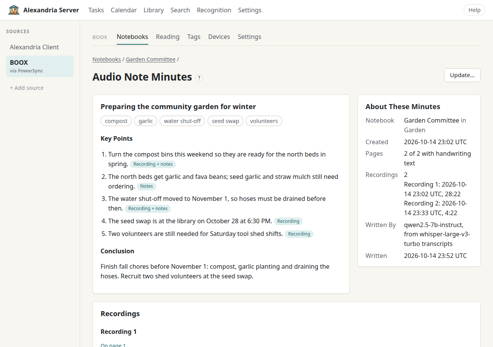

# Audio Note Minutes

Audio Note Minutes summarize a BOOX note from its recordings **and** its
handwriting together. Talk Insights on the tablet only hears the audio; here,
what you wrote down counts as much as what was said. Each recording is
transcribed, then a summary model writes the minutes: an overall **topic**,
**4–6 keywords**, **up to five key points** (each marked as coming from the
recording, your notes, or both) and a **conclusion**, plus the full timestamped
transcripts. The minutes stay on this server and are searchable. Your original
notebook is never changed; you can send a copy of the minutes to your BOOX as a
separate text note if you like.

## What You Need First

In **Settings → AI Tools and Recognition → Audio Note Minutes**:

| Part | Setting | Notes |
| --- | --- | --- |
| **Transcription** | **Enable transcription**, **Base URL**, **Model**, **Language**, **API key** | Any OpenAI-compatible `/v1/audio/transcriptions` server: OpenAI, vLLM, or a self-hosted Whisper server. Enter the base address without `/v1`. Leave **Language** blank to detect it automatically. The key is optional for local servers. |
| **Summary Model** | **Enable summaries**, **API format**, **Base URL**, **Model**, **API key** | OpenAI Chat Completions (including local servers such as vLLM) or Anthropic Messages. |
| **Summary Instructions** | A text box | What the model is told about writing minutes. See [Editing the Instructions](#editing-the-instructions). |
| **When Minutes Are Ready** | **Send them to BOOX automatically**, **Language of headings in minutes notes** | See [Sending Minutes to BOOX](#sending-minutes-to-boox). |

**Test transcription** sends one second of a synthetic tone; **Test summary**
sends a one-line synthetic prompt. Neither sends your notes. Choose **Save**.
[Set Up AI Models](ai-models.md) and [Local Models](local-models.md) cover
choosing and running these.

For pages whose handwriting hasn't been recognized yet, you'll also want a
vision model for [handwriting recognition](recognition.md).

**Costs:** hosted providers may charge for each transcription and each
summary. Unchanged recordings aren't transcribed again when
you update minutes.

## Making Minutes for a Note

1. Open a BOOX notebook that has recordings. The page view has an **Audio Note
   Minutes** card saying how many recordings it has.
2. Choose **Summarize this note…**. The review page shows, before anything is
   sent:
   - **Recordings**: each one's title, when it was recorded, length and size.
   - **Handwriting**: how many pages have recognized text. If some don't, tick
     **Recognize the N pages without text first** to send them to your
     recognition provider first (charges may apply; the minutes wait until
     recognition finishes). Untick it to leave those pages out.
   - **Send**: which transcription and summary models will be used.
3. Tick **Send the recordings and this notebook's text to these providers** and
   choose **Summarize**.
4. Wait. The minutes page shows **In progress** with what it's doing
   ("Transcribing recordings.", "Waiting for handwriting recognition.") and a
   **Cancel** button. Long recordings take a while; go make tea.

**Notes without recordings:** the viewer only shows the card for notebooks that
have recordings, but the minutes page itself handles a note with none: it says
the minutes would come from handwriting alone and offers **Summarize this
note…**.

## Reading the Minutes Page

- **Topic, keywords, Key Points, Conclusion.** Each key point has a badge:
  **Recording**, **Notes** or **Recording + notes**.
- **Keyword chips.** A filled chip is also one of your BOOX tags; select it to
  see the pages that have that tag. Plain chips aren't tags. Alexandria tells the
  summary model about your tags, so a keyword that means the same as a tag
  uses the tag's spelling.
- **About These Minutes**: the notebook and folder, when it was created, how
  many pages had handwriting text, each recording with its start time and
  length, which models wrote it (**Written By**) and when (**Written**).
- **Recordings**: each recording with a player, the page it sits on (**On page
  N** links to that page) or **Not on a page** if its chip was deleted, its
  status (**Transcribed**, **Transcribing…**, **Not transcribed**, or a
  transcription failure), and a **Transcript** you can expand, with timestamps.

In the notebook viewer, a page that holds recording chips also gets a
**Recordings on This Page** card with players, so you can listen while you look
at what you wrote.

## Keeping Minutes Up to Date

Minutes are marked **out of date** when a recording, a recognized page, the
note's BOOX tags or the summary instructions change: "The notebook or the
summary instructions have changed since these minutes were written."
Updating is always your choice:

- **Update…** (top right when minutes are ready) opens the same review page.
  Unchanged recordings aren't transcribed again.
- **Request again…** appears instead when the last request didn't finish.
- **Cancel** stops minutes that are in progress; **Retry** restarts failed or
  cancelled ones. While an update runs, the previous minutes stay visible.

## Sending Minutes to BOOX

The **On Your BOOX** card on the minutes page creates a text note named after
the notebook with `_Minutes` on the end, in the same folder, on every
connected BOOX device.

1. Tick the confirmation ("Create “*title*_Minutes” in *folder* on every
   connected BOOX device") and choose **Send to BOOX**.
2. The card shows the note's status:

| Status | Meaning |
| --- | --- |
| **Sending** | Reaches your devices with their next sync. |
| **On your BOOX** | It's there. It syncs like any other notebook; there's nothing more to do. |
| **Not sent** | It couldn't be sent; the reason is shown. Try again. |
| Edited on a device | It's yours now. Sending again adds a separate note and leaves that one alone. |
| Deleted on a device | Sending again creates a new note. |

**Replacing it.** After an update, open **Replace It on Your BOOX**, tick
"Replace “*title*_Minutes” on every connected BOOX device with these minutes"
and choose **Replace on BOOX**. This rewrites the note with the minutes as they
stand; it never summarizes again (that's **Update**). The earlier copy is
replaced only if it's untouched. If you've edited it, written on it, renamed
it or moved it, it's kept and a new note is added. Merely opening a note
doesn't count as changing it.

The note has the topic and keywords, key points as bullets with their source,
the conclusion, and an "About these minutes" section. **Language of headings in
minutes notes** sets the language of those headings and labels: English,
**Match the recordings**, or another available language. The minutes
themselves are written in the recordings' language.

## Automatic Summaries and Sending

Automatic summaries are **on by default** once transcription and a summary
model are set up. To turn them off, untick **Summarize notes with new
recordings automatically** under **Settings → AI Tools and Recognition →
Automatic Processing** and choose **Save automatic processing**.

- It starts minutes for a note whose recording arrived **after automatic
  processing started**, once the note has gone without changes for **Wait
  before summarizing** (ten minutes unless you change it), recognizing its
  unrecognized pages first. Any change to the note, including a new recording,
  restarts the wait, so recordings restarted within it end up in one set of
  minutes. Set it to **0** to start as soon as a recording reaches the server;
  a note you're still recording in is then summarized again after each new
  recording.
- Minutes that went out of date only because of handwriting wait for you to
  update them, and failed minutes wait for your retry.
- Skipped notebooks are left alone.

With **Send them to BOOX automatically** also ticked, finished minutes go to
your tablets exactly as if you'd pressed **Send to BOOX**. Turning it on doesn't
send minutes that already exist. If an automatic send fails, the minutes stay
ready, the problem shows on the minutes page, and **Send to BOOX** tries again.

## Search and Assistants

Ready minutes appear in [Search](search-and-tags.md) as **Minutes**, linking to
the minutes page; the topic, keywords, key points, conclusion and transcripts
are all searchable. [Assistants](assistants.md) connected over MCP can read
them with the `get_note_minutes` tool, with or without transcripts.

## Editing the Instructions

The **Summary Instructions** box shows the built-in instructions, so you can
edit them in place: tone, length, what to emphasize. Alexandria always adds the
response format it needs (shown under **Response Format (Always Added)**), so
the minutes always have a topic, keywords, key points and a conclusion. Clear
the box and save to go back to the built-in ones. Changing them marks existing
minutes out of date; nothing is rewritten until you summarize a note again.

## Typed-Text Notes on the Tablet

Minutes notes are ordinary BOOX text notebooks, and the viewer shows any text
notebook (yours or the server's) the same way:

- The preview draws the typed text with your handwriting layered on top, as
  the tablet does. It uses a substitute font, so line breaks and layout may
  differ from the device, and the page says so.
- Headings, paragraphs, bulleted, numbered and checklist items, bold, italic,
  underline and strikethrough are drawn. Formatting the server doesn't know is
  shown as plain text, with a notice.
- Images in typed text (PNG, JPEG or WebP) are drawn across the text width. An
  image that hasn't synced yet, or can't be read, shows a placeholder.
- Very long text is cut off at the end of the preview, with a notice.
- Typed text becomes searchable without being sent to any model: the page's
  recognition card says "Typed text from this text notebook; nothing was sent
  for recognition."

To check that server-created notes reach your tablets, **BOOX → Settings →
Create a test text note** makes a new text notebook from text you type, in a
folder you choose. Existing notebooks are never changed. Delete the test note on
a device when you're done.

## Troubleshooting

| Symptom | Cause | Fix |
| --- | --- | --- |
| The review page says to set up transcription and a summary model | One of them isn't enabled | Set both up in Settings → AI Tools and Recognition, then try again. |
| No **Audio Note Minutes** card in the viewer | The notebook has no recordings that reached the server | Let the tablet sync. If recordings are missing, see **Recover audio…** under the notebook's **Source and History**. |
| Failed: "A recording could not be transcribed: …" | The transcription server refused or failed | Check the transcription settings with **Test transcription**, then **Retry**. |
| "The recording is larger than the transcription upload limit (64 MiB)." | A very long recording | Keep future recordings shorter; this one can't be transcribed. |
| "The recording changed after it was requested." | The tablet synced a newer version mid-request | Choose **Request again…**. |
| "Nothing to summarize: no speech was transcribed and no page has recognized text." | Silent audio and unrecognized pages | Recognize the pages, or check the recording plays. |
| "The summary model didn't return minutes in the expected format; retrying." | The summary model wandered off-format | It retries by itself; if it keeps failing, try a more capable model. |
| Minutes are marked out of date | Something in the note changed | Choose **Update…** when you're ready. |
| "Couldn't send these minutes to BOOX automatically" | The folder is gone, or no BOOX device is connected | Fix that, then use **Send to BOOX**. |
| Sending again made a second note | The earlier copy had been edited, renamed or moved on a tablet | Working as intended: your edits win. Delete the one you don't want on the tablet. |
