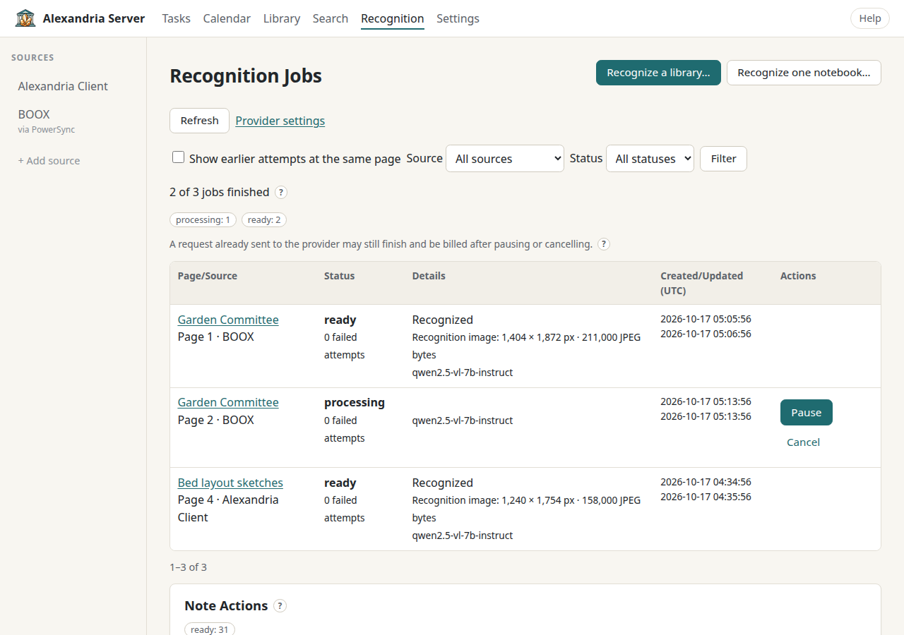

# Recognize Handwriting

Handwriting recognition sends images of your notebook pages to a vision model
you choose and stores the text it sends back. That text is what makes
handwritten pages searchable, what [note actions](note-actions.md) read, and
what [Audio Note Minutes](minutes.md) combine with your recordings. BOOX text
stays on this server: it becomes searchable here but never changes your BOOX
notebooks. Alexandria Client text can sync back to Client devices.

**It can cost money.** Every page sent to a hosted model is a billable request.
Once a recognition provider is set up, automatic recognition sends new BOOX
pages to it (you can turn that off); anything else waits for you to confirm a
request. Pages that haven't changed reuse their earlier result instead of
being sent again.

## What You Need First

- A vision model set up and **Enable recognition** ticked under
  **Settings → AI Tools and Recognition → Provider**. See
  [Set Up AI Models](ai-models.md) (or [Local Models](local-models.md) if you
  run your own).
- Some notebooks. BOOX notebooks arrive through PowerSync (see
  the [BOOX guide](boox.md)); Alexandria Client notebooks arrive from the Client
  app.

Pages are sent as a JPEG of at most 1 MB and 4096 pixels on the long side.
Pages are never enlarged; quality is reduced before size. Base64 encoding adds
about a third to the request size, which matters if your provider has a
request size limit.

## Four Ways to Recognize Pages

| Scope | Where | What it sends |
| --- | --- | --- |
| Automatic | **Settings → AI Tools and Recognition → Automatic Processing** | New BOOX pages, as notebooks change |
| One page | The **Handwriting Recognition** card in the notebook viewer | That page |
| One notebook, or some of its pages | **Recognition → Recognize one notebook…** | The page range you pick |
| A whole library | **Recognition → Recognize a library…** | Every page in the notebooks you keep in the review |

**Recognition** in the top navigation opens the Recognition Jobs page
(`/jobs`), where all of this is tracked.

Alexandria Client pages are already recognized as they sync, so the automatic
setting only concerns BOOX.

### Automatic Recognition

Automatic recognition is **on by default** as soon as a recognition provider
is set up. The **Automatic Processing** card on **Settings → AI Tools and
Recognition** says when it has been on since. To turn it off, untick
**Recognize new BOOX pages automatically** and choose **Save automatic
processing**.

What it does, precisely:

- It queues pages that have **never been recognized**, in notebooks that
  **change after it starts**. Your existing library isn't swept up when you
  set up a provider; use a library run for that.
- It waits until a notebook has been **quiet for five minutes**, because pages
  sync in pieces and you may still be writing.
- **Skipped** notebooks and pages are left alone (see [Skipping](#skipping)).
- It starts the first time it has something to do, once its provider is set
  up. Turning automatic processing completely off and on again restarts the
  clock: only notebooks that change after the new start count.

Separately from this setting, a page that has already been recognized is
re-read when its ink changes, so its text stays current.

### Recognize One Page

Open a notebook and go to the page. The **Handwriting Recognition** card on the
right shows the page's status and its recognized text, if any. Choose
**Recognize this page** to send it, then reload the page later to see the
result (or follow it on the Recognition Jobs page).

### Recognize One Notebook or Chosen Pages

1. Open **Recognition** and choose **Recognize one notebook…** (or use the
   **Choose pages…** link on a notebook's recognition card to skip straight to
   step 3).
2. Search notebook titles and pick one. Only the first 50 matches are listed,
   so narrow the search if yours isn't there.
3. Set **First page** and **Last page**. Use the same number twice for a single
   page. One request can cover up to 20,000 pages.
4. Leave **Recognize again even if a matching result is cached** off unless you
   really want fresh results; on means paying again for unchanged pages.
5. Tick **I agree to send these pages to my configured recognition provider.
   Provider charges may apply.** and choose **Queue selected pages**.

Pages that are already queued, running or paused keep their existing jobs
rather than being queued twice. BOOX pages without a complete preview wait
until they can be drawn.

### Recognize a Whole Library

1. Open **Recognition → Recognize a library…** (each source's Notebooks page
   also has **Recognize this library…**).
2. Pick **Alexandria Client** or **BOOX** under **Source** and choose
   **Choose source**.
3. Choose **Prepare library review**. Alexandria lists every live notebook from
   that source and counts its pages. **This is free and doesn't contact your
   provider.** It keeps going if you close the browser; come back through
   **Recognition** under **Recent Library Batches**.
4. **Review Before Starting** shows **Notebooks Checked**, **Pages Found** and
   **Notebooks Unavailable**. Every available notebook is included. Open
   **Exclude Notebooks** and tick **Exclude** beside anything you want to leave
   out; the page count on the send button updates as you go. If some
   notebooks are unavailable (their page list hadn't fully synced), choose
   **Retry unavailable catalogs** after the next sync.
5. Choose **Send N pages to *model***. Only now are pages sent. Or choose
   **Cancel review** to walk away with nothing sent.

What's covered: BOOX notebook pages, including reading notes, but not book
files or handwriting in NeoReader; Client notebook pages, but not books or
reading annotations. A review can hold up to 10,000 notebooks. Pages added
after the review need a new review.

**Library Batch Progress** shows **Done**, **Pace** (pages a minute over the
last ten minutes) and **Time Left**, plus two count tables:

| Pages | Meaning |
| --- | --- |
| **Recognized** | Finished with text (or found blank) |
| **Recognizing Now** | Being sent right now |
| **Queued** | Waiting for the worker |
| **Not Yet Dispatched** | Still to be handed to the worker; pages go out in chunks of up to 100 |
| **Paused** | Held by you |
| **Failed** / **Blocked** | Didn't produce text; select the number to see those jobs |
| **Cancelled** | Stopped by you |
| **Skipped by You** | Pages you've told Alexandria to leave alone |
| **Left in Earlier Jobs** | Already queued, running or paused elsewhere when this batch started, so left in their original jobs |

The notebook table counts **In This Batch**, **Excluded** and **Unavailable**.
The buttons are **Pause library batch**, **Resume library batch**, **Retry
failed and blocked pages** and **Cancel unfinished**.

## The Recognition Jobs Page

Every page request lands here, whichever way it started. While anything is
queued or processing, the page updates itself every few seconds.

**Filters:** **Source** (all, BOOX, Alexandria Client), **Status**, and **Show
earlier attempts at the same page**. Earlier attempts at a page that has since
been retried or recognized again are hidden unless you tick that box. Results
come 50 at a time with **Previous** and **Next**.

Each row shows the page and source, its status and failed-attempt count,
details (including the prepared image size and the model that read it), and
the created/updated times in UTC. **View batch** filters to the request it
belongs to; batch views add **Pause batch**, **Resume batch**, **Retry
failures** and **Cancel unfinished**.

### Job States

| State | What it means | Buttons |
| --- | --- | --- |
| **queued** | Waiting its turn. After a temporary failure, *Eligible* shows when it'll be tried again. | **Pause**, **Cancel**, **Skip** |
| **processing** | Being sent to the provider now. | **Pause**, **Cancel** |
| **ready** | Done. The text is stored and searchable. Blank pages and typed-text pages finish here without anything being sent. | — |
| **failed** | The provider couldn't be used, or a temporary problem lasted five attempts. | **Retry**, **Cancel**, **Skip** |
| **blocked** | Never sent, because the page couldn't be drawn completely. | **Retry**, **Cancel**, **Skip** |
| **paused** | Held by you; nothing happens until you resume. | **Resume**, **Cancel**, **Skip** |
| **cancelled** | Stopped by you. Earlier successful text isn't erased. | **Skip** |
| **skipped** | Left out of recognition until you un-skip it. | **Un-skip** |

Failed, blocked and cancelled jobs count as finished in the totals, but they
didn't produce text.

### Retrying

**Retry** on a row queues that page again. Filtering **Status** to failed or
blocked adds **Retry these N jobs**, which retries the *whole* filtered list,
not just the 50 on screen. If the list changed since you loaded it, nothing
is retried and you're asked to look again. Retrying sends pages to your
provider again, so charges may apply; pages that still can't be drawn are
blocked again before anything is sent. Unchanged successful results are reused.

### Skipping

A skipped page stays out of recognition: library runs, retry buttons,
**Recognize this page** and changes on the device don't queue it.

- Skip a page with **Skip** on its row, or a filtered list with **Skip them**
  beside the bulk retry.
- Un-skip it by filtering **Status** to skipped and choosing **Un-skip**.
- Skip a whole notebook with **Skip this notebook in recognition** on its
  **Choose pages…** screen. Its unrecognized pages are skipped, and so are
  pages added later. Pages already recognized keep their text and stay
  searchable. **Stop skipping this notebook** lets it back in; the pages its
  skip covered become *cancelled*, so recognize them when you want them.
  Pages you skipped one by one stay skipped.

### Cleaning up obsolete jobs

**Clean up list…** previews blocked BOOX jobs marked **Page was removed.**
when the server can confirm the notebook is deleted or the page is no longer
in a valid page list. Choose **Clear these jobs from the list** to hide them
from the normal list and its counts. The preview checks all BOOX jobs,
regardless of your filters, in groups of up to 200.

This keeps notebook content, source queues and recognition history. Select
**Show earlier attempts and cleared jobs** to see cleared entries again.
Genuine recognition failures and uncertain source metadata stay on the list.
The server rechecks the reviewed jobs when you submit; if they changed,
nothing is cleared and you get a fresh preview. A restored page can still
create fresh recognition work.

### Note Actions and Audio Note Minutes

Below the jobs table, two more sections appear when there's something to
show: **Note Actions** (colored-ink pages being turned into tasks and events,
with their color and result) and **Audio Note Minutes** (minutes that are
queued, running or failed, or that couldn't be sent to BOOX). Each row links
to its notebook. See [Turn Ink Into Tasks and Events](note-actions.md) and
[Audio Note Minutes](minutes.md).

## Reading Recognized Text

In a BOOX notebook, the **Handwriting Recognition** card beside each page shows
the status badge and the recognized text. The page preview stays exactly as
you wrote it; the text is a server-side copy. Typed text and text boxes on a
page appear in a separate **Page Text** card, which needs no recognition at all.
Recognized text also shows up in [Search](search-and-tags.md) and is available to
[assistants](assistants.md).

## What Pause and Cancel Can't Undo

Pause and cancel stop results from being published, but **a request already
sent to the provider may still finish and be billed**. Its late result is
thrown away. Resuming may send that page again. Neither button is a refund
button; if you're watching a budget, pause before you start a large run, not
halfway through the invoice.

## Troubleshooting

| Symptom | Likely cause | Fix |
| --- | --- | --- |
| Buttons are disabled or say to set up a provider | Recognition isn't enabled | Tick **Enable recognition** in Settings → AI Tools and Recognition and save. |
| Nothing happens automatically | Automatic recognition is turned off, the notebook hasn't changed since it started, or it hasn't been quiet for five minutes | Check **Automatic Processing**; use **Recognize one notebook…** or a library run for older notebooks. |
| Jobs **failed** with "The provider rejected authentication or model access" | Wrong key, model name or API format | Fix the provider in Settings, use **Test without saving**, then **Retry**. |
| "Provider rejected the request (HTTP …)" | Wrong endpoint, model or format | Check the base URL (no `/v1`), model and API format, then retry. |
| "Anthropic requires a valid workspace ID" | Your Anthropic key can reach several workspaces | Fill in **Anthropic workspace ID** under **More Options**. |
| "Provider rate or quota limit; waiting to retry" | The provider is throttling you or out of credit | It retries by itself; check your provider's billing if it persists. |
| "Stopped after 5 attempts" | A temporary problem didn't clear | Fix what the detail names, then **Retry**. |
| Jobs **blocked**: "Not sent for recognition because the preview is incomplete" | Some of the page's files haven't synced, or the page uses something the server can't draw | Let the tablet finish syncing and **Retry**. If it stays blocked, **Skip** it. |
| A library review shows notebooks **Unavailable** | Their page list hadn't fully synced | Sync the tablet, then **Retry unavailable catalogs**, or start a new review. |
| A page you expected isn't found by search | It was never recognized | Check its card in the viewer; recognize it. |
