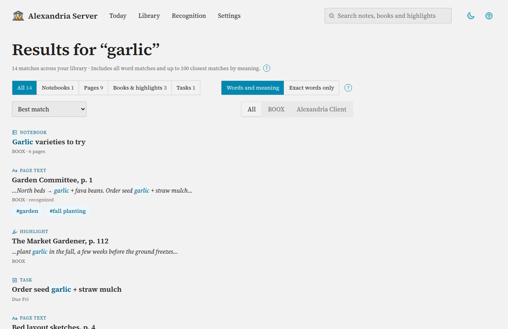

# Search Your Library

Search looks through everything Alexandria can read in your library at once:
notebook titles, handwriting that has been recognized, typed BOOX text notes,
Audio Note Minutes, books and highlights from both sources, and tasks. Out of
the box it matches the words you type. Connect an embedding model and it can
also find pages by meaning, so a search for "watering schedule" turns up the
page where you wrote "irrigate the beds every other morning". BOOX tags you add
on the tablet help too: a tagged page turns up for its tag even when the
handwriting never says the word.

## What You Need First

- Some content: a connected Alexandria Client device or a BOOX tablet running
  PowerSync (see [Connect BOOX Tablets](boox.md)).
- For handwriting: pages that have been through recognition. A page that was
  never recognized can only be found by its notebook title. See
  [Recognize Handwriting](recognition.md).
- Optional, for search by meaning: an embedding endpoint, set up in
  [Set Up AI Models](ai-models.md) (or [Run Models on Your Own Hardware](local-models.md)).

## What Gets Searched

| Tab | What it holds | Found by |
|---|---|---|
| **Notebooks** | BOOX and Alexandria Client notebooks whose title contains every word you typed (ignoring case). | Title text |
| **Pages** | Recognized handwriting from both sources, typed BOOX text notes, and Audio Note Minutes with their transcripts. | Words, and meaning when it's on |
| **Books & highlights** | BOOX books, highlights and bookmarks from NeoReader; Alexandria Client books (by title or author) and their annotations. | BOOX: words, and meaning when it's on. Client: exact words |
| **Tasks** | Tasks whose title or details contain every word. Deleted tasks are left out; finished ones are marked **Done**. | Exact words |

BOOX tags count as words on the page they're on (see below). Nothing is
searchable on a BOOX page until it has recognized text. If a search misses a
page you know is there, check its recognition state first.

## Searching

1. Type into the search box in the top bar (up to 256 characters) and press
   Enter. The box keeps your words on the results page so you can refine them.
2. The tabs across the top split the results by kind and show how many each
   has. **All**, the default, mixes them into one list: the best match of each
   kind first, then the second best of each, and so on.
3. Optional, when search by meaning is on: choose **Words and meaning** (the
   default) or **Exact words only**.
4. Optional: sort by **Best match**, **Title: A–Z** or **Z–A**, or the date the
   notebook, book or task was created. Client book annotations have no creation
   date and sort last.
5. Optional, when BOOX is set up: narrow to **BOOX** or **Alexandria Client**
   with the switch on the right. A task belongs to a source when a note action
   or a Client page made it; tasks you added yourself only show under **All**.

Each result shows its kind, a title that links to the page, notebook, book or
task (for example "Garden plans, p. 3"), a snippet with your words
highlighted, its source, and any BOOX tags on the page. Select a tag to see
every page that carries it. Results come 20 to a page. Each kind lists its
best 500 matches; the counts are always complete, and a note says when a list
stops short.

### Words vs. Meaning

| Mode | What it does |
|---|---|
| **Exact words only** | Matches the words you typed, as whole words. "garden" doesn't find "gardens", so try variations. |
| **Words and meaning** | Does the word match, then adds pages whose meaning is close even if the wording differs. Pages that match your words still rank higher. |

The mode switch only appears once search by meaning is on. Notebook titles,
Client books and their annotations, and tasks always use exact words. If the embedding service is
unreachable when you search, you quietly get word results instead of an error.

## Turning On Search by Meaning

Search by meaning needs an index: every searchable page's text is sent to the
embedding model once, and the results are stored on your server.

1. Set the embedding endpoint and model under **Settings → AI models**, in
   the **Search by meaning** group. The details are in
   [Set Up AI Models](ai-models.md).
2. Go to **Settings → Search by meaning**. The **Status** panel shows three separate
   things:
   - **Provider**: whether the saved embedding service answers.
   - **Semantic Search**: whether you turned the feature on.
   - **Index**: **Not built**, **Building**, **Updating**, **Ready**, or
     **Needs attention**.
3. Select **Test connection** if you want to check the endpoint first.
4. Select **Enable and build index**.

While it builds, the page updates itself every 15 seconds with progress, pace
and an estimated finish time. Word search keeps working the whole time, and
search by meaning starts once the first build finishes.

> **Cost:** building the index sends your existing searchable text to the
> embedding provider. A local Ollama server costs nothing but time; a hosted
> embedding API may charge per token. After that, only new or changed text is
> sent.

### Index Buttons

| Button | What it does |
|---|---|
| **Enable and build index** | Turns the feature on and builds the first index. |
| **Build index** / **Build replacement index** | Builds a new index, for example after changing the embedding model. The old one stays in use until the new one is ready. |
| **Turn off** | Pauses embedding work and keeps the index. Word search is unaffected. |
| **Turn on and resume** | Turns it back on and continues with the index you already have. |
| **Retry failed index work** | Shown when some records failed; queues them again. |
| **Test connection** | Checks the saved embedding endpoint. |

**Coverage by Source** shows, per source, how much text is available, how much
is embedded, and how much is pending or failed. BOOX pages without recognized
text are never indexed; the page says how many there are and links to
recognizing them. Search by meaning never starts handwriting recognition on its
own.

## BOOX Tags

BOOX Notes lets you tag a piece of a page. Alexandria picks those tags up and
uses them in search, on notebook pages, and in [Audio Note Minutes](minutes.md).

### Adding a Tag on the Tablet

1. In a BOOX notebook, select ink with the lasso.
2. Choose **Tag** from the lasso's actions. The tablet suggests text from its
   own handwriting recognition; edit it if you like and confirm.
3. Close the note. Tags reach Alexandria when the note is saved on the
   device, and PowerSync syncs it.

Tags you create in the tablet's tag manager without putting them on a page
also arrive; they show as "Not on any page".

### Tags in the Web App

- **Library → Tags** (on the BOOX side) lists every tag with how many pages and notebooks carry it.
  Select a tag to see the pages that have it (matching ignores case, like the
  tag search on the tablet). **Search for it** runs a library search for the
  tag's text.
- A BOOX notebook page shows a **BOOX Tags** card: the tags **On this page**,
  and the notebook's other tags under **Elsewhere in this notebook**.
- Search results show each page's tags as links.

### How Tags Affect Search

- A tag works like a strong keyword: searching for it finds the tagged page
  even if the handwriting never mentions it. It counts for about as much as
  saying the word a couple of times, so it doesn't push a page above others
  that discuss the topic at length.
- A tag only helps once the page has recognized text. An unrecognized tagged
  page still appears on the tag's own page under **BOOX → Tags**, but not in
  search results.
- Adding or removing a tag doesn't re-send the page to the embedding model.

### Read-Only

Alexandria only reads tags. It never creates, renames or removes tags on your
tablets. To change a tag, do it on the device; the change arrives with the
next sync.

## Troubleshooting

| Symptom | Likely cause | Fix |
|---|---|---|
| A BOOX page you know is there doesn't show up | The page hasn't been recognized; only its notebook title is searchable | Open the notebook, check **Page text** in **Page details**, and select **Recognize this page** or recognize the library. See [Recognize Handwriting](recognition.md). |
| A tagged page doesn't appear when searching for its tag | The page has no recognized text yet | Recognize the page. It already appears under **BOOX → Tags**. |
| A new tag hasn't arrived | The note is still open on the tablet, or hasn't synced | Close the note on the device and let PowerSync sync. |
| No **Words and meaning** menu | Search by meaning is off | Turn it on in **Settings → Search by meaning**. |
| Index stuck on **Not built**, buttons greyed out | The provider isn't ready | Check the endpoint in **Settings → AI models**, then **Test connection** in **Settings → Search by meaning**. |
| "The existing index was built with different provider settings" | You changed the embedding model or endpoint | Select **Build replacement index**. The old index keeps working meanwhile. |
| **Index** shows **Needs attention** | Some records failed to embed | Select **Retry failed index work**; if failures persist, check the embedding server's logs. |
| Searching "gardens" misses "garden" | Word matching is exact | Try the other form, or turn on search by meaning. |
| "Invalid search query or source." | The query is longer than 256 characters, or the BOOX source isn't enabled | Shorten the query; pick **All sources**. |
