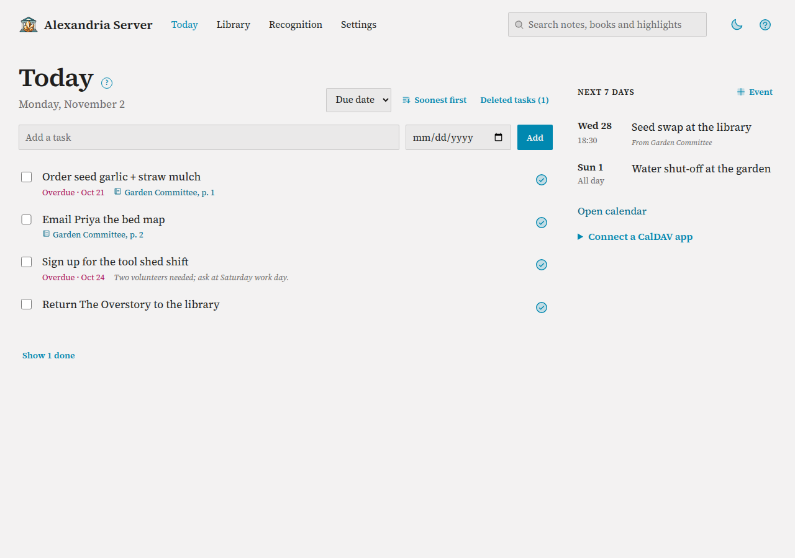
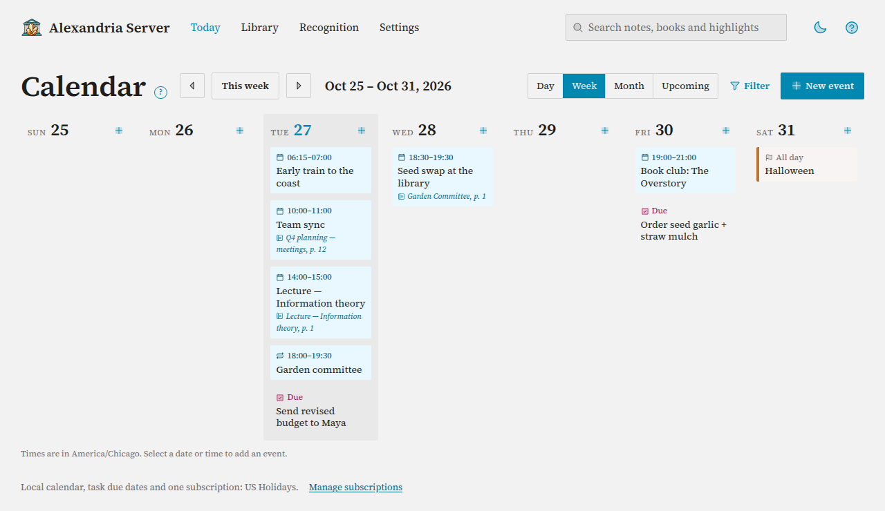

# Tasks and Calendar

Alexandria keeps one task list and one calendar for your library. You can add
and edit items in the web app, sync them to your phone or desktop with any
CalDAV app, have an AI assistant manage them, and (with
[Note Actions](note-actions.md)) create them by writing in color on a BOOX
page. Everything is the same list everywhere: tick a task done on your phone
and it's done in the web app too.

## What You Need First

- A running Alexandria Server you can sign in to.
- To sync with apps: an address your phone or computer can reach. Away from
  home that usually means HTTPS through a reverse proxy; see
  [Put Alexandria Behind HTTPS](https-proxy.md).
- Your time zone set (below), so due dates and event times land on the right
  day.

## Set Your Time Zone

1. Go to **Settings → Calendar & tasks**.
2. Pick your zone from **Time zone**. **Server default** uses the server's own
   zone. If your browser reports a different zone, a hint offers **Use it**.
3. Select **Save**.

The time zone is used for task due dates and event times written or typed
without a time zone, including those from note actions. The web Calendar shows
times in this zone.

## Tasks

**Today** is the home page: select **Today** in the top bar. Open tasks are
on the left, the next seven days of events on the right. A tinted **Needs
attention** line appears when recognition has pages waiting for you or an
Alexandria Client device needs a restore; each part links to where you fix it.

### Adding and Editing

1. Type into **Add a task**, optionally pick a due date, and select **Add**
   (or press Enter).
2. To change a task, select its title. It opens in place: change the
   **Title**, **Due date** and **Notes**, then **Save**, or **Cancel**. **No
   due date** empties the date. **Delete** here moves the task to Deleted
   tasks.
3. Select the tick beside a task to mark it done.

Under each title: when it's due (**Due today**, **Due tomorrow**, **Due Fri**,
**Overdue · Oct 20**; today and overdue are highlighted), the notebook page it
came from, and the start of its notes.

Due dates in the web app are dates only. A CalDAV app can set a time of day;
see **Due dates** below.

### Sorting

Pick **Due date**, **Created**, **Updated** or **Title** from the menu beside
the date. The link next to it flips the order (**Soonest first** / **Latest
first**, **Oldest first** / **Newest first**, or **A–Z** / **Z–A**).

### Several Tasks at Once

Tick the boxes beside tasks. A bar appears with how many you picked:

| Button | What it does |
|---|---|
| **Mark done** | Completes the ticked tasks. |
| **Reopen** | Puts completed tasks back with the open ones. |
| **Delete** | Moves the ticked tasks to Deleted tasks. |
| **Clear** | Unticks everything. |

### Done Tasks

Completed tasks are hidden; **Show 1 done** (with the count) lists them, struck
through, each with **Reopen**. **Clear completed tasks** moves every completed
task to Deleted tasks in one go.

### Deleted Tasks

Deleting is a two-step affair, on purpose.

1. **Delete** moves a task to **Deleted tasks** (the link at the top of the
   page shows how many are there). It disappears from your apps but can be
   brought back.
2. In Deleted tasks, select **Restore** to bring a task back. To erase it,
   tick **Permanently** beside it, then **Delete**. To erase several, tick
   them, tick **Delete the selected tasks permanently** in the bar, and select
   **Delete permanently**.

A permanently deleted task is erased for good: your devices are told it's
gone, and a device that still has an old copy can't bring it back.

### Where a Task Came From

A task made from a notebook page links to it, with the page number: **Garden
Committee, p. 7**. That covers tasks made by [Note Actions](note-actions.md)
from a BOOX page and tasks made from an Alexandria Client page.

### Next 7 Days

The right-hand column lists events from today through the next week, from your
local calendar and every enabled subscription, with the notebook an event came
from. Select one to open it. **+ Event** adds one; **Open calendar** shows the
full calendar.

## Calendar

Select **Open calendar** on Today. The calendar has four views:

- **Week** shows seven columns of events, today's filled in. Each day's **+**
  adds an event that day.
- **Day** is an hour grid from 07:00 to 22:00. It grows to fit an event that
  starts earlier or ends later, so nothing is squeezed out. All-day events and
  tasks due sit in a row above it. Select an empty hour to add an event then.
  Overlapping events share the width.
- **Month** shows up to three items a day; **+N more** opens that Day. Select a
  date's number to add an event on it.
- **Upcoming** lists the next 7, 14, 30 or 90 days, grouped by day, starting
  today. **Show next 30 days** reaches further, and **Show past 30 days** adds
  the month behind you.

The arrows move by a day, week or month; **Today**, **This week** or **This
month** comes back. This browser remembers the view and the first day of the
week; returning to Calendar starts at today's date. Everything works with
JavaScript disabled.

Events show their time, title and, when a note action made them, the notebook
and page: **Garden Committee, p. 7**. A repeat icon marks a recurring event and
a flag marks one from a subscribed calendar.

**Task due dates** appear in magenta with **Due**: open tasks with a due date,
on that date (with the time, when the task has one). Selecting one opens the
task's editor on Today.

### Filtering

**Filter** opens a row of filters, and reads **Filter · on** while any apply:

- **Search** matches titles, places and descriptions; every word must match,
  regardless of case. It stays in the address, so a link keeps it.
- **Local calendar**, **Task due dates** and each subscription show or hide
  that calendar. This browser remembers the choice, and Today's Next 7 days
  follows it too.
- **Week starts on** picks Sunday or Monday.
- **Clear filters** shows everything again, and **Deleted events (n)** opens
  the deleted events.
- **Go to date** jumps to a date.

### Adding an Event

1. Select **+ New event**, a day's **+**, an empty hour in Day, or a date in
   Month. The editor opens in a column beside the calendar, with the start at
   that hour (09:00 otherwise) and the end an hour later.
2. Enter a title, and adjust the date, times, location or description. Tick
   **All day** for an event without times.
3. Select **Save**. Save and Cancel return to the same view.

**More options** holds the end date (for an event over several days), the UTC
offsets, and a link. Times are in the time zone from Settings. When daylight
saving time repeats a local hour, the UTC offsets tell its two occurrences
apart. A local time that doesn't exist produces a message, and the editor keeps
what you typed.

### Editing an Event

Select an event to open it in the editor. Events from note actions show
**From note: Garden Committee, p. 7**, linking to the page. Older links to the
separate edit page open the editor instead.

### Deleting and Restoring

**Delete…** in the editor moves an event to **Deleted events** (under
**Filter**). There you can **Restore** it, or select **Delete permanently…**,
tick the box and confirm to erase it from every CalDAV app too.

Imported recurring events and their exceptions appear in every view. Selecting
one opens its details, read-only, in the editor column: edit or delete the
series in your CalDAV app. Web edits cannot flatten the series.
Repeat rules, reminders, attendees and original calendar blobs are preserved.

If a series is malformed, unsupported, or too large to expand safely, a notice
names it and marks the results incomplete. Use your CalDAV app to inspect it;
an incomplete result does not mean the series has no events.

## Connect a CalDAV App

Alexandria serves two CalDAV collections under one account:

| Collection | Holds | Address |
|---|---|---|
| Task list | Tasks (VTODO) | `https://alexandria.example.com/caldav/user/calendars/tasks/` |
| Calendar | Events (VEVENT) | `https://alexandria.example.com/caldav/user/calendars/events/` |

Open **Connect a CalDAV app** near the heading on Today, or
**Settings → Calendar & tasks**. It shows your server's discovery address
and the relevant collection address, with Copy buttons. If copying is blocked,
the address is selected so you can copy it manually. The address fields also
work without JavaScript.

Apps that support discovery can start from the server address alone:
`https://alexandria.example.com/` (Alexandria answers `/.well-known/caldav`).

**Credentials:** your Alexandria username and password, the same ones you use
to sign in to the web app. API tokens don't work as a CalDAV password.

Alexandria supports incremental sync, so apps fetch only what changed.

### Names Apps Show

In **Settings → Calendar & tasks**, **Task list name** and **Calendar
name** set what your apps display for the two collections.

### Example Setups

The menu names below belong to each app and may differ between versions.

**DAVx5 (Android):**

1. Add an account with **Login with URL and user name**.
2. Base URL: `https://alexandria.example.com/`; enter your username and
   password.
3. Turn on both collections. Use a tasks app DAVx5 supports (such as
   jtx Board, Tasks.org or OpenTasks) for the task list.

**Apple Calendar and Reminders (macOS, iOS):**

1. Add a CalDAV account: in the system's account settings choose
   **Other**, then a CalDAV account (on macOS, also from Calendar's
   Settings → Account).
2. Server: `alexandria.example.com`, plus your username and password.
3. The task list appears in Reminders and the calendar in Calendar.

**Thunderbird:**

1. Create a new calendar **On the Network**.
2. Enter your username and the location
   `https://alexandria.example.com/caldav/user/calendars/events/`, or the
   server address to let it find both collections.
3. Thunderbird shows the task list under Tasks.

BOOX Calendar Memo can also use the calendar with the same address and account.

### Due Dates

Some apps handle due times badly (a task due "today" ends up due yesterday at
11 p.m.). **Due dates** in **Settings → Calendar & tasks** fixes that:

| Setting | Effect |
|---|---|
| **Keep the time of day** | A due date stays as the app wrote it: date-only stays date-only, a time stays a time. |
| **Date only** | Drops the time of day from due dates, both ways. |

## What Syncs

| Item | Synced fields |
|---|---|
| Tasks | Title, status (done or not), due date, notes, and deletions. Other fields an app sets are kept and sent back to apps. |
| Events | Title, start and end, all-day, location, link, notes, and deletions. Repeat rules, reminders and attendees are kept as the app wrote them. |

Changes go both ways: the web app, CalDAV apps, note actions and an
[AI assistant](assistants.md) all edit the same items. Apps see changes on
their next sync.

## Troubleshooting

| Symptom | Likely cause | Fix |
|---|---|---|
| The app says the login failed | Wrong username or password, or you used an API token | Use the account you sign in to the web app with. |
| The app can't find any calendars | Discovery isn't reaching Alexandria, often because a reverse proxy doesn't pass `/.well-known/caldav` | Enter the full collection address from **Settings → Calendar & tasks** instead, or fix the proxy (see [Put Alexandria Behind HTTPS](https-proxy.md)). |
| Tasks show up in a calendar app but not events (or the other way round) | Only one collection was added | Add both addresses, or turn on both collections in the app. |
| Due dates are a day off | Time zone not set, or the app mishandles due times | Set **Time zone**; if it persists, choose **Date only** under **Due dates**. |
| A deleted task is missing from Deleted Tasks | It was deleted permanently | Permanent deletion can't be undone. |
| Events show at the wrong hour | Time zone not set | Set it in **Settings → Calendar & tasks**. |

## Subscribe to a public calendar

Select **Manage subscriptions** at the foot of Calendar, or open **Settings →
Calendar & tasks → Calendar subscriptions**. Enter a name, choose a color, and paste
an HTTPS iCalendar (ICS) feed address, a Google Calendar share/embed link, or a
webpage containing one calendar. Alexandria resolves Google calendar IDs and
looks for embedded Google calendars or explicit ICS links on the page, then
checks the complete feed before saving. No JavaScript or Google sign-in is needed.
If several calendars are found, paste the share link or ICS URL for the specific
calendar you want. Pages that require scripts to generate their calendar links
need a direct share/ICS link. The calendar must be publicly accessible.

Subscribed events appear in every view with a flag and the calendar's colour.
Selecting one opens its details, read-only, in the editor column: make changes
at the source. The filter row shows or hides each subscription. Subscriptions do
not add events to Alexandria's writable CalDAV collection or its event API.

Alexandria refreshes enabled subscriptions every 30 minutes. **Refresh now**
requests an earlier refresh; repeated requests are limited to one attempt per
30 seconds. Settings shows the last successful refresh and any error. A failed
refresh keeps the last good snapshot, and Calendar says so: **School term
dates: Refresh failed: The calendar source returned HTTP 404. Check that the
feed is public. Showing the Oct 19 snapshot.**, with **Manage** to fix it. An unsupported time zone or recurrence rule
produces an incomplete-results notice instead of silently hiding the problem.
Uncheck **Enable calendar and automatic refresh** to pause a source. **Unsubscribe**
removes its cached events after confirmation and leaves local events untouched.

Public feeds need no Google sign-in. There is a limit of 20 subscriptions, 4 MiB
per downloaded feed, and 2,000 event series per source. The Server worker must be
running for refreshes; normal page loads read the cached snapshot.

Example checked on 2026-10-19: the [TCDP Community Calendar page](https://www.traviscountydemocrats.org/tcdp-calendar)
embeds a public Google Calendar. Its direct [public ICS feed](https://calendar.google.com/calendar/ical/info%40travisdems.org/public/basic.ics)
and the webpage URL can both be pasted into the subscription form.
