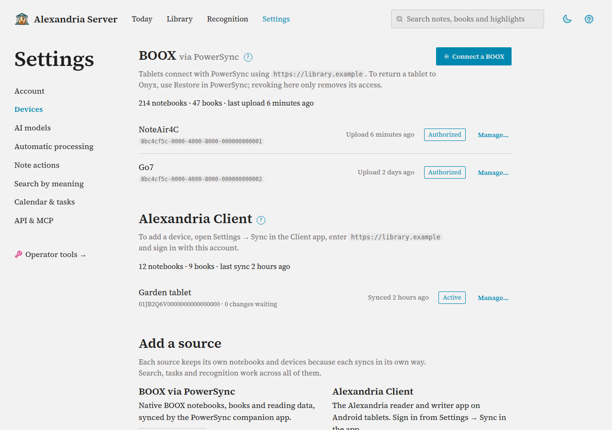

# Using the Web App

The web app is where you browse your library, search it, manage tasks and
events, run handwriting recognition and change settings. It runs in any modern
browser, desktop or phone, at your server's address. This guide is a tour of
the screens so you know where things live; the feature guides go deeper.

## What You Need First

- A running server (see [Install Alexandria Server](install.md)) and its
  address, for example `https://alexandria.example.com` or
  `http://192.0.2.10:8080` on your home network.
- The username and password set during installation.

## Signing In

Open the server's address. Your browser asks for a username and password;
enter your Alexandria account. The browser remembers them for the session, so
you won't be asked on every page.

To change your password, go to **Settings → Account → Change password**. Use
at least 12 characters (up to 72 bytes). Your browser may ask you to sign in
again; enrolled devices and API tokens keep working.

## Finding Your Way Around

### Top Bar

From left to right:

| Link | Goes to |
|---|---|
| **Today** | Your tasks and the next seven days of events (also the home page). See [Tasks and Calendar](tasks-and-calendar.md). |
| **Library** | Your notebooks, books and tags, one source at a time. |
| **Recognition** | Handwriting recognition jobs, with a count when pages need attention. See [Recognize Handwriting](recognition.md). |
| **Settings** | Account, search, AI models and integrations. |

The search box searches notes, books and highlights (see [Search Your Library](search-and-tags.md)). The moon and sun switch between the dark and light themes, and **?** opens the built-in guide.

## The Library

**Library** opens on the source you looked at last. Each source keeps its own notebooks and devices because each syncs in its own way; search, tasks and recognition work across all of them. When BOOX is set up, the switch beside the tabs moves between **BOOX** and **Alexandria Client**:

| Source | Tabs |
|---|---|
| BOOX | **Notebooks**, **Books**, **Tags** |
| Alexandria Client | **Notebooks**, **Books** |

The **More** menu holds **Recognize this library…**, the BOOX maintenance pages, **Devices** and **+ Add source** (both in Settings).

## Browsing Notebooks

Notebooks are listed on the left, newest first; sort by name, pages, or created or modified date, and flip the order. **All notebooks** lists every notebook with its folder; **Folders** goes one folder at a time. Dates are in your time zone (**Settings → Calendar & tasks**). BOOX lists also have a title search and a **Type** filter (handwritten, text, reading and other note types).

Click a notebook to preview it on the right: its first eight pages, its folder and how many pages have recognized text. Double-click it, or choose **Open**, to read it.

- **BOOX** notebooks can be renamed, moved, sent to the tablets' Trash, restored or removed permanently from the preview. See [Connect BOOX Tablets](boox.md#the-notebook-preview).
- **Alexandria Client** notebooks offer **Open**, **Download PDF** and **Delete…**. Deleting removes the notebook from every Client device on its next sync. There's no trash, and a later edit on a device brings it back.

## Books and Tags

**Books** lists each source's books; click one to see its highlights and notes beside the list. BOOX books can be uploaded, downloaded, renamed, moved between shelves and sent to Book Trash (see [Connect BOOX Tablets](boox.md#manage-stored-books)); Alexandria Client books can be downloaded, and their handwritten annotations show with the text recognized from them. **Tags** (BOOX) lists every lasso tag; click one for the pages that carry it.

### Reading a Notebook

Open a notebook to see one page at a time. The header has **← Library**, which goes back to the
list with the notebook selected, then the page box and **Go**, **Page** / **All pages**, **Fit
page** or **Actual size**, and **Page details**. A filmstrip of every page runs above the page;
select one to jump there, or use the arrows beside the page or the ← and → keys. **All pages**
shows the whole notebook as a grid.

**Page details** opens a drawer beside the page and remembers whether you left it open. What it
shows depends on the source and what the page has:

| Section | Shows |
|---|---|
| **Page text** | The page's recognized text, its date and model on BOOX or its model on the Client, with **Recognize this page** or **Recognize again**. |
| **Note actions** (BOOX) | Each ink color's state and the tasks or events made from it, with **Find actions**. See [Note Actions](note-actions.md). |
| **Tags** (BOOX) | Tags on this page and elsewhere in the notebook. |
| **Audio note minutes** (BOOX) | The note's minutes, marked when they're out of date, or **Summarize this note…**, then the recordings on this page. See [Audio Note Minutes](minutes.md). |

At the bottom of the drawer: **Download PDF** for both sources, plus **Rename…** on BOOX or
**Delete…** on the Client.

BOOX previews are drawn on the server from the ink files received so far.
They're read-only: nothing you do while browsing changes your tablets.

### Alexandria Client Books

**Books** lists books the Client has imported, with author, format,
annotation count and a **Download** link. Open a book to read its
annotations. Client devices are in **Settings → Devices** (below).

BOOX tablets are covered in [Connect BOOX Tablets](boox.md).

## Getting Help in the App

- **?** buttons beside headings open a short explanation. Each has a **Learn
  more** link into the guide.
- **Help** (top right, and in the footer) opens the full in-app guide, with
  sections from **Getting Started** to **Operator Notes**.
- The footer shows the running version, handy when reporting a problem.

## Settings

**Settings** has one page per section, listed down the left (across the top on
a phone). A successful save shows **✓** and what changed beside its button.

| Section | What's there |
|---|---|
| **Account** | **Change password**, **Language**, **Theme** (match this device, light or dark), and **About this server** (the address and version). |
| **Devices** | BOOX tablets with their last upload, **Connect a BOOX** (a one-time pairing code), and revoking; Alexandria Client devices with their last sync, changes waiting and **Needs restore**, plus rename, **Clear sync position** and revoke; and **Add a source**. Each source shows its notebook and book counts. |
| **AI models** | The handwriting recognition provider, the Audio note minutes models and their instructions, and the search-by-meaning model. See [Set Up AI Models](ai-models.md). |
| **Automatic processing** | Whether changed notebooks are recognized and summarized automatically, and how long to wait first. |
| **Note actions** | Which pen colors make tasks or events, and their instructions. See [Note Actions](note-actions.md). |
| **Search by meaning** | Status, index building and coverage. See [Search Your Library](search-and-tags.md). |
| **Calendar & tasks** | CalDAV addresses, collection names, time zone, due-date handling and calendar subscriptions. See [Tasks and Calendar](tasks-and-calendar.md). |
| **API & MCP** | The MCP address and API tokens. A new token is shown once, on this page. See [Connect an AI Assistant](assistants.md). |

**Operator tools**, at the foot of the list, gathers maintenance you won't need
day to day: clearing a Client device's sync position, the BOOX record browser
and observed versions, cleaning up numbered notebooks, notebook operations,
deleted notebooks and Book Trash, cleaning up the recognition job list,
notebook size limits (the recognition page limit and per-notebook overrides),
reprocessing recognized pages, and this server's version, PostgreSQL version
and storage. Recovering audio and refreshing a book's reading data work on one
item at a time, so they stay on the notebook's and the book's pages.

## Choosing a Language

1. Go to **Settings → Account**.
2. Under **Language**, pick one from **Show Alexandria in**, or **Your
   browser's language** to follow your browser.
3. Select **Save language**.

The choice is saved in this browser only, so set it on each browser you use.
Text that Alexandria writes onto your tablets, such as headings in minutes
notes, is set separately under **Settings → AI models**. Want
Alexandria in your language? See [Translate Alexandria](translating.md).

## Pages That Update Themselves

Some pages refresh their figures in place while work is running, so you can
leave them open:

- **Recognition** (every few seconds while jobs are queued or running).
- A whole-library recognition run in progress.
- **Settings → Search by meaning** while the index builds (every 15 seconds).

Without JavaScript, these pages reload themselves instead.

## On a Phone

The layout adapts to small screens: the sources sidebar becomes a row at the
top, the top bar scrolls sideways, and the notebook side panel moves below the
page. Wide tables scroll horizontally. The app follows your system's light or
dark setting.

## Troubleshooting

| Symptom | Likely cause | Fix |
|---|---|---|
| The browser keeps asking for a password | Wrong username or password | Use the account set at installation. To reset the password, from `deploy/compose` run `printf '%s' 'new-password-here' \| docker compose --profile setup run --rm --no-deps -T seed-admin` (at least 12 characters). |
| No **BOOX** in the sidebar | The BOOX source isn't enabled on this server | See [Connect BOOX Tablets](boox.md). |
| "Nothing here yet. Notebooks appear after a device syncs." | No Client device has synced | Connect one from **Devices** in the Alexandria Client source. |
| A BOOX page says a preview isn't available | Some of its files haven't arrived yet | Give the tablet time to sync; a missing preview doesn't mean the page is blank. |
| The language didn't change on another computer | Language is saved per browser | Set it in **Settings → Account** there too. |
| Counts on the Recognition page look frozen | JavaScript is blocked and the page is waiting to reload | Reload the page, or allow scripts for the site. |
